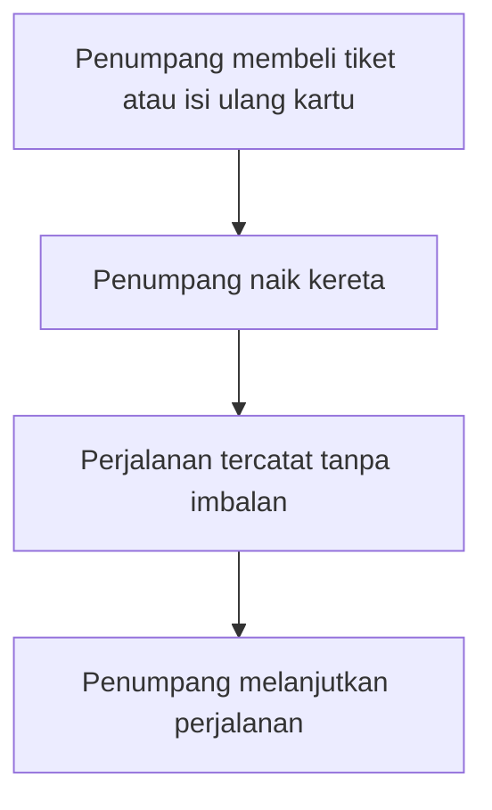
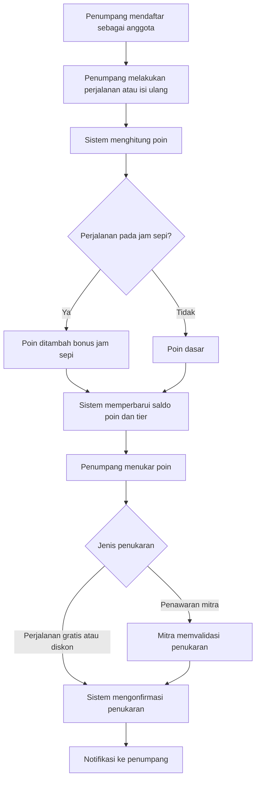
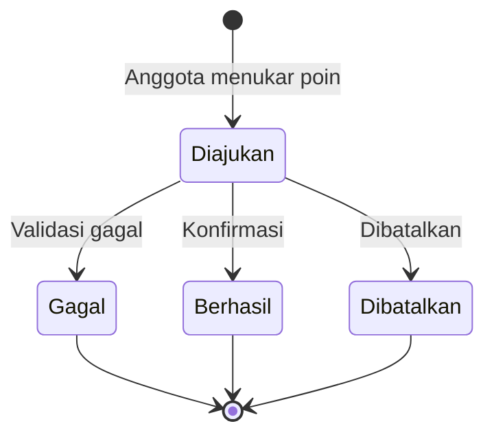

# Customer Loyalty
## Layanan Transportasi Publik

## Informasi Dokumen
| Atribut | Keterangan |
|---|---|
| Nama Dokumen | BRD Customer Loyalty Apps |
| Versi | 1 |
| Tanggal | 12 November 2026 |
| Penyusun | @septian.narsa |
| Status | Public |

---

## Ringkasan Eksekutif

Program loyalty ini dirancang untuk penumpang layanan transportasi publik dalam hal ini MRT. Program memberi reward atas frekuensi setiap perjalanan, lalu menukar poin dengan perjalanan voucher yang tersedia atau penawaran mitra di tempat yang telah ditentukan oleh mitra. Program dijalankan melalui aplikasi dan terhubung dengan metode pembayaran nontunai.

Program ditujukan untuk tiga hasil utama: menambah frekuensi penumpang, memberikan benefit tambahan pada penumpang, dan meningkatkan pemakaian layanan mitra di stasiun. Cakupan fase awal, aturan poin, dan tier/leveling.

---

## Latar Belakang dan Permasalahan

### Latar Belakang

Layanan transportasi publik melayani penumpang reguler, penumpang sesekali, dan turis. Kepadatan penumpang terjadi pada jam sibuk, sementara jam sepi belum termanfaatkan. Tempat seperti stasiun juga memiliki potensi trafik untuk mitra ritel dan F&B. Diharapkan penumpang, mitra seperti ritel dan F&B bisa mendapat benefit tambahan dari meningkatnya pengguna transportasi publik.

### Permasalahan Kondisi Saat Ini

| No | Permasalahan | Dampak Bisnis |
|---|---|---|
| P1 | Belum ada insentif bagi penumpang reguler untuk menambah frekuensi perjalanan | Peluang kenaikan ridership tidak tergarap |
| P2 | Belum ada program apresiasi dan retensi penumpang | Loyalitas dan retensi penumpang sulit dibangun |
| P3 | Mitra di stasiun belum memanfaatkan trafik penumpang secara terarah | Potensi pendapatan dari layanan pendukung belum optimal |
| P4 | Data perjalanan penumpang belum dipakai untuk penawaran yang dipersonalisasi | Promosi kurang tepat sasaran |
| P5 | Belum ada cara bergabung bagi penumpang tanpa smartphone atau turis | Sebagian penumpang tidak dapat ikut program |

---

## Tujuan Bisnis dan Indikator Keberhasilan

### Tujuan Bisnis

| ID | Tujuan |
|---|---|
| BO-01 | Meningkatkan frekuensi perjalanan penumpang reguler melalui insentif poin dan tier |
| BO-02 | Meningkatkan kepuasan dan retensi penumpang melalui program apresiasi |
| BO-03 | Meningkatkan pemakaian layanan mitra di stasiun |
| BO-04 | Menyediakan dasar data untuk penawaran personal dan pemantauan program |

### Indikator Keberhasilan (KPI)

Target angka belum ditetapkan. Target ditentukan setelah baseline data tersedia.

| KPI | Definisi | Target |
|---|---|---|
| Jumlah perjalanan per anggota aktif | Rata-rata perjalanan per anggota dalam satu bulan | [Usulan] ditetapkan setelah baseline |
| Porsi perjalanan jam sepi | Persentase perjalanan anggota pada jam sepi | [Usulan] ditetapkan setelah baseline |
| Tingkat partisipasi | Persentase penumpang aktif yang menjadi anggota | [Usulan] ditetapkan setelah baseline |
| Tingkat retensi | Persentase anggota yang tetap aktif pada periode berikutnya | [Usulan] ditetapkan setelah baseline |
| Tingkat penukaran poin | Persentase poin yang ditukar terhadap poin yang diperoleh | [Usulan] ditetapkan setelah baseline |
| Kepuasan penumpang | Skor kepuasan dari survei anggota | [Usulan] ditetapkan setelah baseline |

---

## Ruang Lingkup

### Dalam Lingkup (In Scope)

| No | Modul | Keterangan |
|---|---|---|
| 1 | Keanggotaan | Pendaftaran dan profil anggota dalam aplikasi |
| 2 | Poin | Perolehan poin dari perjalanan dan isi ulang kartu |
| 3 | Tier | Tingkatan anggota (contoh: Silver, Gold, Platinum) |
| 4 | Penukaran | Tukar poin dengan perjalanan gratis, diskon, atau penawaran mitra |
| 5 | Off-peak | Bonus poin atau diskon untuk perjalanan jam sepi |
| 6 | Promosi mitra | Penawaran dari mitra ritel dan F&B di stasiun |
| 7 | Referral | Insentif untuk pengajakan anggota baru |
| 8 | Umpan balik | Survei dan masukan dari anggota |
| 9 | Pelaporan | Dashboard performa program |

### Di Luar Lingkup (Out of Scope)

| Item | Catatan |
|---|---|
| Integrasi lintas moda (bus, komuter line, MRT) | Usulan fase lanjutan **[Usulan]** |
| Kemitraan transportasi online | Usulan fase lanjutan **[Usulan]** |
| Cashback | Belum disebut sebagai kebutuhan **[Usulan]** |
| Donasi dan kegiatan komunitas berbasis poin | Usulan fase lanjutan **[Usulan]** |

---

## Stakeholder dan Aktor

| Aktor | Organisasi | Peran |
|---|---|---|
| Penumpang Reguler | Pengguna | Mengumpulkan poin dan menukar hadiah |
| Penumpang Sesekali / Turis | Pengguna | Bergabung dan menukar poin tanpa keharusan memakai smartphone |
| Operator Transportasi MRT | Internal | Pemilik program dan pengambil keputusan aturan |
| Tim Pemasaran | Internal | Kampanye dan komunikasi program |
| Tim Operasional Stasiun | Internal | Pendampingan penumpang dan layanan di stasiun |
| Tim IT dan Data | Internal | Integrasi sistem dan analitik |
| Mitra (ritel, F&B) | Eksternal | Penyedia penawaran penukaran poin |
| Penyedia pembayaran | Eksternal | Pembacaan tap dan pencatatan transaksi |
| Sistem Loyalty | Sistem | Perhitungan poin, tier, dan penukaran |

---

## Proses Bisnis

### Proses As-Is

| Langkah | Aktor | Aktivitas |
|---|---|---|
| 1 | Penumpang | Membeli tiket atau mengisi ulang kartu |
| 2 | Penumpang | Naik kereta |
| 3 | Sistem | Mencatat perjalanan tanpa imbalan |

### Proses To-Be

### Perbandingan As-Is dan To-Be

| Aspek | As-Is | To-Be |
|---|---|---|
| Keanggotaan | Tidak ada | Pendaftaran melalui aplikasi atau cara alternatif **[Usulan]** |
| Imbalan perjalanan | Tidak ada | Poin per perjalanan dan isi ulang **[Usulan]** |
| Pemakaian jam sepi | Tidak ada dorongan khusus | Bonus poin pada jam sepi **[Usulan]** |
| Penukaran | Tidak tersedia | Perjalanan, diskon, dan penawaran mitra **[Usulan]** |
| Promosi mitra | Tidak terarah | Penawaran berdasarkan data dan lokasi stasiun **[Usulan]** |
| Pemantauan | Tidak tersedia | Dashboard performa program **[Usulan]** |

---

## Aturan Bisnis (Business Rules)

### Aturan Poin

| ID | Aturan |
|---|---|
| BR-PT-01 | Poin diberikan untuk setiap perjalanan atau sesuai rules yang dikonfigurasi pada sistem |
| BR-PT-02 | Nilai poin per perjalanan ditetapkan oleh Operator MRT |
| BR-PT-03 | Perjalanan pada jam sepi mendapat bonus poin dengan persentase yang ditetapkan Operator MRT |
| BR-PT-04 | Poin memiliki masa berlaku yang ditetapkan Operator MRT |
| BR-PT-05 | Poin yang kedaluwarsa tidak dapat ditukar dan akan hangus |
| BR-PT-06 | Setiap perubahan saldo poin dicatat dalam riwayat transaksi |

### Aturan Tier

| ID | Aturan |
|---|---|
| BR-TR-01 | Tier ditentukan oleh frekuensi perjalanan dan/atau nilai belanja dalam periode tertentu |
| BR-TR-02 | Ambang setiap tier ditetapkan Operator MRT |
| BR-TR-03 | Tier yang lebih tinggi memberi manfaat tambahan (poin lebih besar, diskon, atau layanan khusus) |
| BR-TR-04 | Tier dievaluasi ulang secara berkala |

### Aturan Penukaran

| ID | Aturan |
|---|---|
| BR-RD-01 | Poin dapat ditukar dengan voucher, diskon, atau penawaran mitra tergantung program yang sedang berjalan |
| BR-RD-02 | Nilai tukar poin ditetapkan Operator Transportasi |
| BR-RD-03 | Penukaran yang gagal mengembalikan poin ke saldo anggota |
| BR-RD-04 | Penukaran dapat dibatalkan sesuai ketentuan yang ditetapkan |

### Aturan Promosi dan Mitra

| ID | Aturan |
|---|---|
| BR-PM-01 | Mitra hanya dapat menawarkan promosi setelah kerja sama disepakati |
| BR-PM-02 | Penawaran mitra dapat dibatasi berdasarkan waktu atau tier |
| BR-PM-03 | Setiap penukaran di mitra tercatat sebagai transaksi |

### Aturan Referral

| ID | Aturan |
|---|---|
| BR-RF-01 | Pengajak dan yang diajak mendapat imbalan setelah pendaftaran berhasil |
| BR-RF-02 | Imbalan referral dibatasi jumlahnya per anggota |

---

## Kebutuhan Bisnis (Business Requirements)

Prioritas memakai skala MoSCoW: **M**ust, **S**hould, **C**ould, **W**on't. Seluruh prioritas bersifat.

### Modul Keanggotaan

| ID | Kebutuhan | Aktor | Prioritas |
|---|---|---|---|
| REQ-MB-01 | Penumpang dapat mendaftar sebagai anggota melalui aplikasi | Penumpang | M |
| REQ-MB-02 | Penumpang dapat bergabung melalui cara alternatif tanpa smartphone | Penumpang sesekali, Turis | S |
| REQ-MB-03 | Anggota dapat melihat profil, saldo poin, dan tier | Anggota | M |

### Modul Poin

| ID | Kebutuhan | Aktor | Prioritas |
|---|---|---|---|
| REQ-PT-01 | Sistem menghitung poin dari setiap perjalanan dan isi ulang kartu | Sistem | M |
| REQ-PT-02 | Sistem memberi bonus poin untuk perjalanan pada jam sepi | Sistem | S |
| REQ-PT-03 | Sistem mencatat riwayat transaksi poin | Sistem | M |
| REQ-PT-04 | Sistem menangani masa berlaku dan kedaluwarsa poin | Sistem | S |

### Modul Tier

| ID | Kebutuhan | Aktor | Prioritas |
|---|---|---|---|
| REQ-TR-01 | Sistem menghitung tier anggota berdasarkan aturan yang berlaku | Sistem | M |
| REQ-TR-02 | Sistem menerapkan manfaat sesuai tier | Sistem | M |
| REQ-TR-03 | Operator MRT dapat mengubah ambang dan manfaat tier | Admin Operator | M |

### Modul Penukaran

| ID | Kebutuhan | Aktor | Prioritas |
|---|---|---|---|
| REQ-RD-01 | Anggota dapat menukar poin dengan perjalanan gratis atau diskon | Anggota | M |
| REQ-RD-02 | Anggota dapat menukar poin dengan penawaran mitra | Anggota | S |
| REQ-RD-03 | Sistem mengembalikan poin jika penukaran gagal | Sistem | M |
| REQ-RD-04 | Anggota menerima notifikasi status penukaran | Anggota | S |

### Modul Off-Peak dan Gamifikasi

| ID | Kebutuhan | Aktor | Prioritas |
|---|---|---|---|
| REQ-OP-01 | Sistem menampilkan informasi jam sepi dan bonus yang berlaku | Anggota | S |
| REQ-OP-02 | Operator MRT dapat membuat tantangan dengan imbalan untuk perjalanan pada waktu atau stasiun tertentu | Admin Operator | C |

### Modul Promosi Mitra

| ID | Kebutuhan | Aktor | Prioritas |
|---|---|---|---|
| REQ-PM-01 | Mitra dapat mengelola penawaran di stasiun yang disepakati | Mitra | S |
| REQ-PM-02 | Sistem menampilkan penawaran sesuai stasiun, waktu, dan tier | Sistem | S |

### Modul Referral

| ID | Kebutuhan | Aktor | Prioritas |
|---|---|---|---|
| REQ-RF-01 | Anggota dapat mengajak orang lain bergabung | Anggota | C |
| REQ-RF-02 | Sistem memberi imbalan referral sesuai aturan | Sistem | C |

### Modul Umpan Balik, Pelaporan, dan Analitik

| ID | Kebutuhan | Aktor | Prioritas |
|---|---|---|---|
| REQ-FB-01 | Anggota dapat mengisi survei dan memberi masukan melalui aplikasi | Anggota | S |
| REQ-RP-01 | Sistem menyediakan dashboard performa program (ridership, jam sepi, penukaran, kepuasan) | Admin Operator | M |
| REQ-RP-02 | Sistem menyediakan data segmentasi anggota untuk penawaran personal | Tim Pemasaran | S |

### Modul Aksesibilitas

| ID | Kebutuhan | Aktor | Prioritas |
|---|---|---|---|
| REQ-AK-01 | Program dapat diakses penumpang tanpa smartphone melalui kartu atau cara lain | Penumpang | S |
| REQ-AK-02 | Informasi program tersedia dalam bahasa yang mudah dipahami | Penumpang | S |

---

## Siklus Status

### Status Anggota

| Status | Arti | Pemicu |
|---|---|---|
| Terdaftar | Anggota baru, belum aktif | Pendaftaran berhasil |
| Aktif | Anggota dapat mengumpulkan dan menukar poin | Verifikasi selesai |
| Nonaktif | Anggota tidak dapat mengumpulkan poin | Tidak aktif sesuai aturan |
| Diblokir | Akses dihentikan | Pelanggaran atau permintaan anggota |

### Status Penukaran

| Status | Arti | Pemicu |
|---|---|---|
| Diajukan | Permintaan penukaran dibuat | Anggota menukar poin |
| Berhasil | Penukaran dikonfirmasi | Sistem atau mitra mengonfirmasi |
| Gagal | Penukaran tidak berhasil | Kesalahan sistem atau validasi |
| Dibatalkan | Penukaran dibatalkan | Anggota atau sistem membatalkan |

### Diagram Transisi Penukaran

---

## Kebutuhan Data

### Entitas Utama

| Entitas | Keterangan |
|---|---|
| Member | Data anggota (identitas, status, tier) |
| Point Ledger | Riwayat perubahan saldo poin |
| Trip | Data perjalanan dan isi ulang yang menjadi dasar poin |
| Tier | Parameter tingkatan anggota |
| Reward | Daftar hadiah dan nilai tukar |
| Redemption | Riwayat penukaran |
| Partner | Data mitra dan penawarannya |
| Referral | Data pengajakan anggota baru |
| Feedback | Data survei dan masukan |

### Ketetapan Data

- Data pribadi anggota dikelola sesuai regulasi perlindungan data pribadi yang berlaku.
- Saldo poin hanya berubah melalui entri pada Point Ledger.
- Sumber data perjalanan berasal dari sistem pembayaran atau tiket.

---

## Kebutuhan Non-Fungsional

| ID | Kategori | Kebutuhan |
|---|---|---|
| NFR-01 | Kinerja | Poin diperbarui setelah perjalanan dalam waktu yang disepakati |
| NFR-02 | Ketersediaan | Layanan tersedia selama jam operasional dan memiliki target uptime yang ditetapkan saat perancangan teknis |
| NFR-03 | Keamanan | Akses berbasis peran untuk anggota, mitra, dan admin |
| NFR-04 | Auditabilitas | Setiap perubahan poin dan tier tercatat dengan waktu dan pelaku |
| NFR-05 | Kompatibilitas | Aplikasi mobile (Android dan iOS) dan web browser modern |
| NFR-06 | Skalabilitas | Mendukung lonjakan penggunaan pada jam sibuk dan hari besar |
| NFR-07 | Retensi data | Riwayat transaksi disimpan sesuai kebijakan perusahaan |

---

## Asumsi, Batasan, dan Dependensi

### Asumsi

1. Sistem pembayaran atau tiket sudah ada dan dapat memberi data perjalanan.
2. Operator Transportasi memiliki wewenang menetapkan aturan poin, tier, dan penukaran.
3. Mitra di stasiun bersedia menjadi penyedia penawaran.
4. Penumpang hanya dapat menggunakan aplikasi untuk bergabung.

### Batasan

1. Nilai poin, ambang tier, dan nilai tukar belum ditetapkan.
2. Integrasi lintas moda berada di luar fase awal.
3. Dokumen ini berdasarkan strategi umum, bukan spesifikasi teknis.

### Dependensi

| Dependensi | Keterangan |
|---|---|
| Sistem pembayaran dan tiket | Sumber data perjalanan dan isi ulang |
| Aplikasi MRT | Tempat program ditampilkan dan dikelola |
| Layanan notifikasi | Pemberitahuan poin, tier, dan penukaran |
| Kesepakatan mitra | Dasar penawaran penukaran |
| Layanan pembayaran nontunai | Pembacaan tap dan pembayaran mitra |

---

## Risiko dan Mitigasi

| ID | Risiko | Dampak | Mitigasi |
|---|---|---|---|
| R1 | Nilai poin dan tier terlalu murah atau terlalu mahal | Biaya program membengkak atau anggota tidak tertarik | Uji coba terbatas dan evaluasi berkala **[Usulan]** |
| R2 | Insentif jam sepi tidak mengubah pola perjalanan | Tujuan BO-02 tidak tercapai | Ukur porsi perjalanan jam sepi dan sesuaikan bonus **[Usulan]** |
| R3 | Data perjalanan tidak lengkap dari sistem pembayaran | Poin tidak akurat | Validasi sumber data sebelum rilis **[Usulan]** |
| R4 | Penumpang tanpa smartphone tidak dapat ikut program | Program tidak inklusif | Sediakan kartu atau cara bergabung alternatif **[Usulan]** |
| R5 | Mitra tidak aktif menawarkan promosi | Pendapatan layanan pendukung tidak tercapai | Kesepakatan kerja sama dan pelaporan performa mitra **[Usulan]** |
| R6 | Kebocoran data pribadi anggota | Kerugian reputasi dan hukum | Enkripsi, kontrol akses, dan audit **[Usulan]** |
| R7 | Biaya program melebihi manfaat | Beban keuangan operator | Pantau dampak pendapatan dan sesuaikan aturan **[Usulan]** |

---

## Traceability: Tujuan ke Kebutuhan

Belum ada user story untuk proyek ini. Traceability dibuat dari tujuan bisnis ke kebutuhan.

| Tujuan | Kebutuhan Terkait |
|---|---|
| BO-01 Meningkatkan frekuensi perjalanan | REQ-PT-01, REQ-TR-01, REQ-TR-02 |
| BO-02 Mendorong perjalanan jam sepi | REQ-PT-02, REQ-OP-01, REQ-OP-02 |
| BO-03 Meningkatkan kepuasan dan retensi | REQ-TR-02, REQ-RD-01, REQ-FB-01 |
| BO-04 Meningkatkan pemakaian mitra | REQ-RD-02, REQ-PM-01, REQ-PM-02 |
| BO-05 Dasar data dan pemantauan | REQ-RP-01, REQ-RP-02 |

---

## Glosarium dan Langkah Selanjutnya

### Glosarium

| Istilah | Arti |
|---|---|
| MRT | Mass Rapid Transit, layanan kereta perkotaan |
| Loyalty | Program yang memberi imbalan atas pemakaian berulang |
| Poin | Satuan imbalan yang dapat ditukar |
| Tier | Tingkatan anggota berdasarkan aktivitas |
| Off-peak | Jam sepi penumpang |
| Redemption | Penukaran poin dengan hadiah |
| Referral | Pengajakan anggota baru |
| Ledger | Riwayat perubahan saldo poin |

---

## Lampiran

### Lampiran A. Kode Transaksi Poin [Usulan]

| Tahap | txn_code | Keterangan |
|---|---|---|
| Perolehan | EARN_RIDE | Poin dari perjalanan |
| Perolehan | EARN_TOPUP | Poin dari isi ulang kartu |
| Perolehan | EARN_OFFPEAK | Bonus poin jam sepi |
| Perolehan | EARN_REFERRAL | Imbalan referral |
| Penukaran | REDEEM_RIDE | Penukaran perjalanan gratis atau diskon |
| Penukaran | REDEEM_PARTNER | Penukaran penawaran mitra |
| Koreksi | REFUND_REDEEM | Pengembalian poin karena penukaran gagal |
| Kedaluwarsa | EXPIRE | Poin kedaluwarsa |
