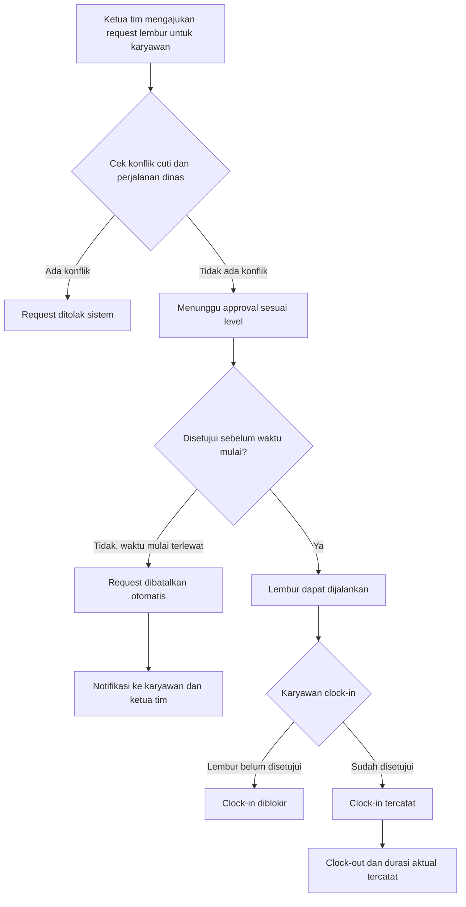
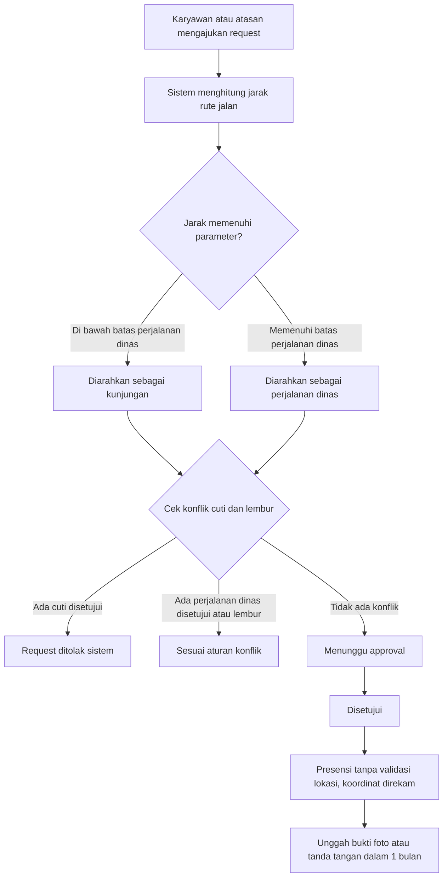
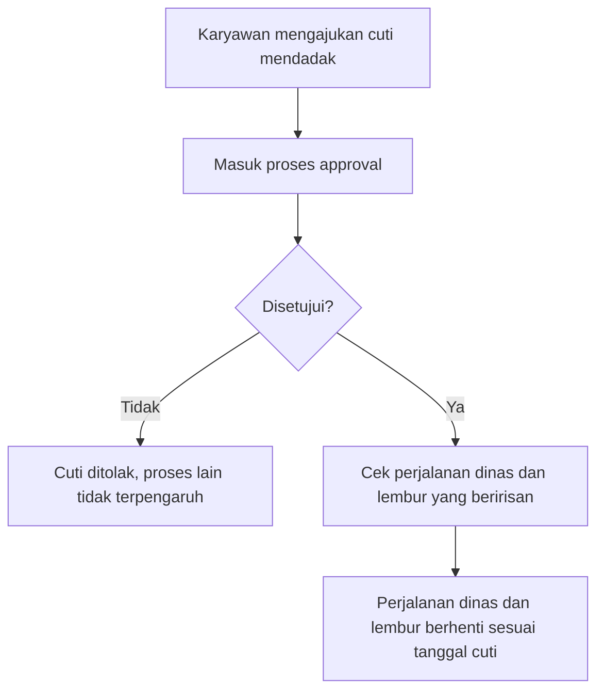
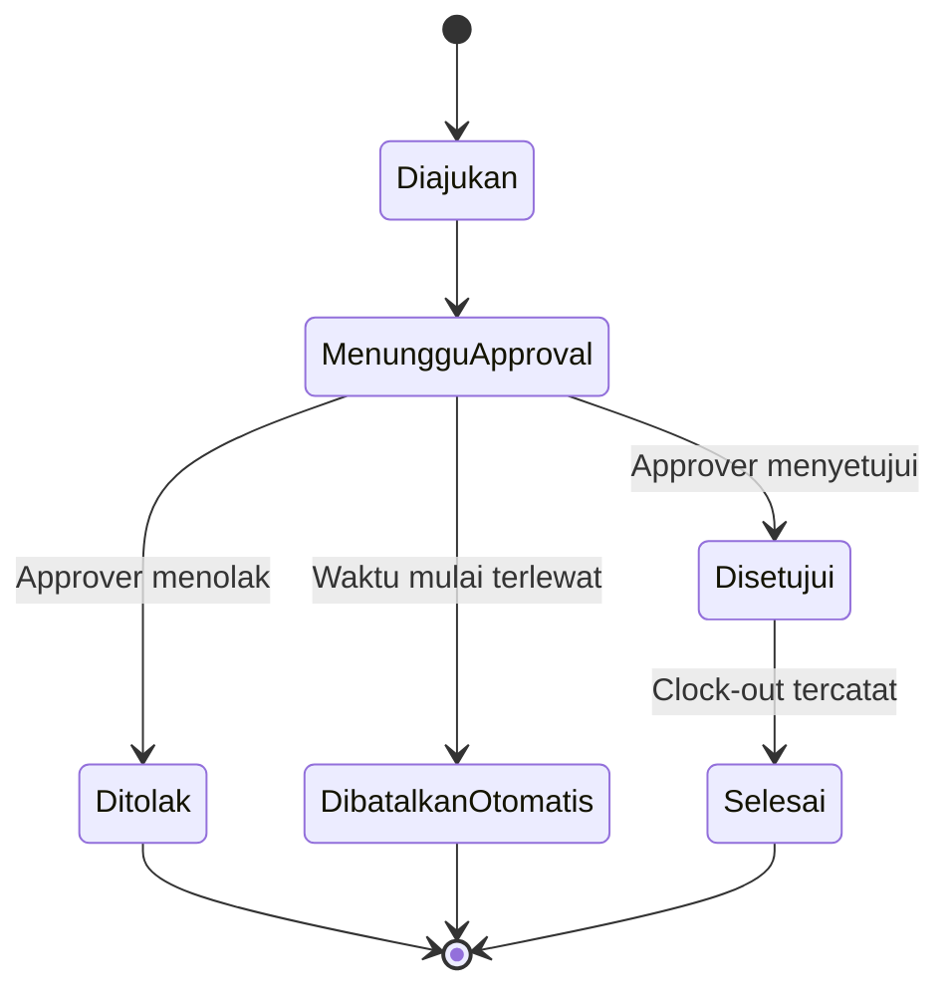
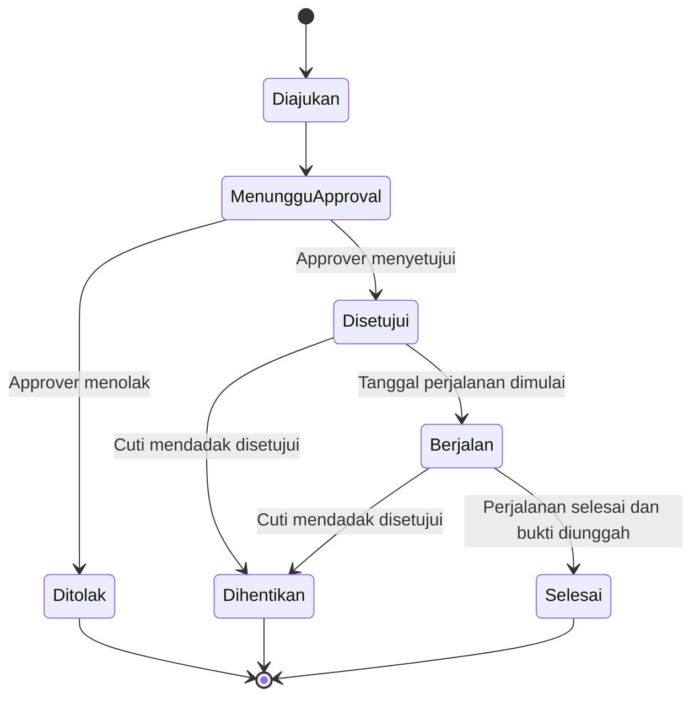

# Digitalisasi HRIS
## Transformasi Digital Perusahaan Enterprise

## 1. Informasi Dokumen

| Atribut | Keterangan |
|---|---|
| Nama Dokumen | BRD Digitalisasi HRIS |
| Versi | 1.0 |
| Tanggal | 14 November 2026 |
| Penyusun | @septiannarsa |
| Status | Public |

**Riwayat Revisi**

| Versi | Tanggal | Penyusun | Perubahan |
|---|---|---|---|
| 1.0 | 14 November 2026 | @septiannarsa | - |

---

## 2. Ringkasan Eksekutif

Perusahaan Enterprise dengan ribuan pegawai berencana menggantikan seluruh aplikasi HRIS yang ada dengan sistem HRIS buatan sendiri. Alasan utamanya adalah beberapa proses bisnis tidak dapat diakomodasi oleh aplikasi existing.

Sistem baru mencakup presensi, lembur, perjalanan dinas, kunjungan klien atau cabang, cuti dan izin, serta pelaporan. Perubahan paling signifikan ada pada lembur, yang sebelumnya dilakukan atas kehendak karyawan di luar sistem, dan kini harus melalui perintah berbasis request yang disetujui sebelum waktu lembur dimulai.

Aplikasi dibangun berbasis web dan mobile. Sistem tidak terintegrasi dengan payroll maupun sistem lain yang sudah digunakan perusahaan.

---

## 3. Latar Belakang dan Permasalahan

| ID | Permasalahan | Dampak Bisnis |
|---|---|---|
| P1 | Aplikasi HRIS existing tidak dapat mengakomodasi sejumlah proses bisnis perusahaan. | Proses dijalankan di luar sistem, data tidak terpusat, dan perusahaan bergantung pada aplikasi pihak ketiga. |
| P2 | Lembur dilakukan atas kehendak karyawan dan tidak ada perintah atau persetujuan sebelum lembur. | Biaya lembur sulit dikendalikan dan tidak dapat diverifikasi. |
| P3 | Lembur tidak tercatat sebagai proses terstruktur, hanya presensi biasa. | Laporan lembur tidak akurat dan tidak dapat dipertanggungjawabkan. |
| P4 | Perjalanan dinas dan kunjungan keluar kantor tidak memiliki bukti kegiatan yang terstandar. | Sulit membuktikan kegiatan saat audit. |
| P5 | Rekap presensi, lembur, perjalanan dinas, dan kunjungan tidak tersedia dalam satu sumber data. | Penyusunan laporan manual dan memakan waktu. |

---

## 4. Tujuan Bisnis dan KPI

### 4.1 Tujuan Bisnis

| ID | Tujuan Bisnis |
|---|---|
| BO-01 | Menggantikan seluruh aplikasi HRIS existing dengan sistem internal yang mengakomodasi proses bisnis perusahaan. |
| BO-02 | Mengendalikan lembur melalui perintah berbasis request dan persetujuan sebelum lembur dimulai. |
| BO-03 | Menyediakan bukti dan jejak audit untuk perjalanan dinas dan kunjungan keluar kantor. |
| BO-04 | Menyediakan rekap terpusat yang dapat diunduh dalam format Excel. |

### 4.2 Indikator Keberhasilan (KPI)

| ID | Indikator | Target | Keterangan |
|---|---|---|---|
| KPI-01 | Persentase proses lembur yang memiliki request disetujui sebelum waktu mulai | 100% |  |
| KPI-02 | Persentase perjalanan dinas dan kunjungan yang memiliki bukti dokumentasi dalam batas 1 bulan | ≥ 95% |  |
| KPI-03 | Waktu rata-rata membuat rekap bulanan dibandingkan kondisi sebelumnya | Berkurang ≥ 50% |  |
| KPI-04 | Jumlah modul yang masih menggunakan aplikasi HRIS existing setelah go-live | 0 | Sesuai keputusan penggantian penuh |

---

## 5. Ruang Lingkup

### 5.1 Dalam Lingkup

| Modul | Deskripsi |
|---|---|
| Presensi | Clock-in dan clock-out dengan validasi lokasi pada kondisi normal. |
| Lembur | Request lembur oleh ketua tim, approval berjenjang, pembatalan otomatis, dan presensi lembur. |
| Perjalanan Dinas | Request perjalanan dinas, approval, presensi tanpa validasi lokasi, perekaman koordinat, dan bukti dokumentasi. |
| Kunjungan Klien atau Cabang | Proses serupa perjalanan dinas untuk jarak pendek dengan parameter yang dapat dikonfigurasi. |
| Cuti dan Izin | Pengajuan dan approval atasan, termasuk aturan konflik dengan proses lain. |
| Konfigurasi (Backoffice) | Pengaturan level approval, parameter jarak, dan parameter lain sesuai kebijakan. |
| Rekap dan Pelaporan | Rekap presensi, lembur, perjalanan dinas, dan kunjungan dalam format Excel. |
| Manajemen Pengguna dan Hak Akses | Pengaturan peran dan akses data. |
| Notifikasi | Notifikasi kepada karyawan dan approver, termasuk notifikasi pembatalan lembur otomatis. |

### 5.2 Di Luar Lingkup

| ID | Hal di Luar Lingkup | Alasan |
|---|---|---|
| OS-01 | Integrasi dengan sistem payroll | Ditetapkan tidak terintegrasi. |
| OS-02 | Integrasi dengan sistem lain yang sudah digunakan perusahaan | Ditetapkan tidak terintegrasi. |
| OS-03 | Validasi lokasi saat perjalanan dinas | Koordinat hanya direkam untuk audit. |
| OS-04 | Eskalasi approval otomatis jika approver tidak merespons | Ditetapkan tidak ada eskalasi. |
| OS-05 | Perhitungan upah lembur dan potongan | Tidak disebutkan dalam kebutuhan; dibahas di sistem payroll. [Usulan] |

---

## 6. Stakeholder dan Aktor

| Aktor / Stakeholder | Peran | Kepentingan Utama |
|---|---|---|
| Karyawan | Pengguna utama presensi, menerima perintah lembur, menjalankan perjalanan dinas atau kunjungan. | Presensi mudah, kejelasan status request, notifikasi. |
| Ketua Tim | Mengajukan request lembur untuk anggota tim. | Pengajuan lembur cepat dan jelas. |
| Approver (Level 1 dan Level 2) | Menyetujui atau menolak request lembur, perjalanan dinas, kunjungan, dan cuti. | Informasi lengkap untuk keputusan. |
| Admin HR (Backoffice) | Mengonfigurasi parameter, level approval, dan hak akses; mengelola rekap. | Kontrol atas konfigurasi dan laporan. |
| Manajemen | Pengguna laporan rekap. | Data akurat untuk pengambilan keputusan. |
| Tim Audit atau Compliance | Memeriksa jejak audit dan koordinat perjalanan. | Jejak audit lengkap dan dapat diverifikasi. |
| Tim IT | Pengembangan, operasional, dan keamanan sistem. | Sistem stabil, aman, dan dapat dipelihara. |

---

## 7. Proses Bisnis

### 7.1 Kondisi Saat Ini (As-Is)

| Proses | Kondisi Saat Ini |
|---|---|
| Presensi | Clock-in dan clock-out pada aplikasi existing. |
| Lembur | Lembur terjadi atas kehendak karyawan di luar sistem. Presensi lembur hanya clock-in dan clock-out biasa. |
| Perjalanan dinas | Terdapat request perjalanan dinas pada aplikasi existing. Proses tertentu tidak dapat diakomodasi. |
| Kunjungan | Belum ada proses khusus untuk kunjungan klien atau cabang. |
| Cuti dan izin | Pengajuan dengan approval atasan. |
| Rekap | Dilakukan dari berbagai sumber. |

### 7.2 Kondisi yang Diharapkan (To-Be)

**Alur Request Lembur**

**Alur Request Perjalanan Dinas dan Kunjungan**

**Alur Cuti Mendadak**

### 7.3 Tabel Perbandingan As-Is dan To-Be

| Aspek | As-Is | To-Be |
|---|---|---|
| Lembur | Atas kehendak karyawan, di luar sistem | Diperintahkan melalui request, disetujui sebelum waktu mulai |
| Presensi saat lembur | Presensi biasa | Clock-in diblokir sampai lembur disetujui |
| Pembatalan lembur | Tidak ada | Otomatis jika belum disetujui saat waktu mulai |
| Approval | Atasan (cuti) | Berjenjang, satu atau dua level, dikonfigurasi di backoffice |
| Perjalanan dinas | Request, tanpa aturan jarak dan bukti terstandar | Request dengan jarak rute jalan, presensi tanpa validasi lokasi, bukti wajib |
| Kunjungan | Belum terstandar | Proses terpisah dengan parameter jarak pendek |
| Koordinat perjalanan | Tidak direkam | Direkam untuk audit |
| Konflik antarproses | Tidak diatur | Aturan konflik eksplisit (lihat Bagian 8) |
| Rekap | Terpisah-pisah | Terpusat, unduh Excel, periode fleksibel |

---

## 8. Aturan Bisnis

### 8.1 Presensi (BR-PRE)

| ID | Aturan |
|---|---|
| BR-PRE-01 | Presensi normal memerlukan validasi lokasi saat clock-in dan clock-out. |
| BR-PRE-02 | Selama perjalanan dinas yang disetujui, presensi dapat dilakukan tanpa validasi lokasi. |
| BR-PRE-03 | Koordinat tetap direkam selama perjalanan dinas, walaupun tidak divalidasi. |
| BR-PRE-04 | Presensi pada hari cuti yang disetujui tidak diizinkan. |

### 8.2 Lembur (BR-LMB)

| ID | Aturan |
|---|---|
| BR-LMB-01 | Request lembur diajukan oleh ketua tim untuk karyawan yang akan lembur, bukan oleh karyawan itu sendiri. |
| BR-LMB-02 | Request lembur harus disetujui sebelum waktu lembur dimulai. |
| BR-LMB-03 | Jika waktu lembur sudah dimulai dan request belum disetujui, request dibatalkan otomatis. |
| BR-LMB-04 | Karyawan dan ketua tim menerima notifikasi saat request lembur dibatalkan otomatis. |
| BR-LMB-05 | Clock-in lembur diblokir sampai request lembur disetujui. |
| BR-LMB-06 | Setelah lembur, karyawan melakukan clock-in dan clock-out seperti presensi biasa. |
| BR-LMB-07 | Durasi aktual lembur boleh berbeda dengan durasi yang disetujui. Sistem mencatat keduanya. |
| BR-LMB-08 | Jumlah level approval lembur (satu atau dua) mengikuti konfigurasi backoffice. |

### 8.3 Perjalanan Dinas dan Kunjungan (BR-PD)

| ID | Aturan |
|---|---|
| BR-PD-01 | Perjalanan dinas dan kunjungan wajib diajukan melalui request dan disetujui. |
| BR-PD-02 | Jarak dihitung berdasarkan rute jalan, bukan garis lurus. |
| BR-PD-03 | Status dalam kota atau luar kota tidak menentukan jenis proses; hanya jarak yang menentukan. |
| BR-PD-04 | Batas jarak minimal perjalanan dinas dan kunjungan dikonfigurasi di backoffice. |
| BR-PD-05 | Karyawan wajib mengunggah minimal satu bukti dokumentasi (foto atau tanda tangan). |
| BR-PD-06 | Batas waktu pengumpulan bukti dokumentasi adalah 1 bulan sejak tanggal perjalanan. |
| BR-PD-07 | Koordinat lokasi selama perjalanan dinas direkam untuk keperluan audit. |

### 8.4 Cuti dan Izin (BR-CTI)

| ID | Aturan |
|---|---|
| BR-CTI-01 | Cuti dan izin diajukan karyawan dan disetujui atasan. |
| BR-CTI-02 | Cuti mendadak tetap melalui proses approval normal. |

### 8.5 Aturan Konflik Antarproses (BR-KNF)

| ID | Kondisi | Aturan |
|---|---|---|
| BR-KNF-01 | Cuti sudah disetujui | Pengajuan perjalanan dinas ditolak sistem. |
| BR-KNF-02 | Cuti sudah disetujui | Pengajuan lembur ditolak sistem. |
| BR-KNF-03 | Perjalanan dinas sudah disetujui | Pengajuan lembur ditolak sistem. |
| BR-KNF-04 | Lembur sudah disetujui | Pengajuan perjalanan dinas diizinkan. |
| BR-KNF-05 | Cuti mendadak disetujui setelah perjalanan dinas atau lembur sudah disetujui | Perjalanan dinas dan lembur yang beririsan berhenti sesuai tanggal cuti yang disetujui. |

### 8.6 Approval (BR-APR)

| ID | Aturan |
|---|---|
| BR-APR-01 | Level approval (satu atau dua) dikonfigurasi di backoffice per kebijakan. |
| BR-APR-02 | Tidak ada eskalasi otomatis jika approver tidak merespons. |
| BR-APR-03 | Request yang belum direspons tetap berstatus menunggu sampai ada keputusan atau dibatalkan otomatis (khusus lembur). |

### 8.7 Rekap dan Pelaporan (BR-RKP)

| ID | Aturan |
|---|---|
| BR-RKP-01 | Rekap dapat diunduh dalam format Excel. |
| BR-RKP-02 | Periode rekap default bulanan dan dapat disesuaikan. |
| BR-RKP-03 | Data rekap hanya dapat dilihat sesuai hak akses pengguna. |

---

## 9. Kebutuhan Bisnis per Modul

| ID | Kebutuhan | Aktor | Prioritas |
|---|---|---|---|
| REQ-PRE-01 | Karyawan dapat melakukan clock-in dan clock-out dengan validasi lokasi. | Karyawan | Must |
| REQ-PRE-02 | Sistem mengizinkan presensi tanpa validasi lokasi selama perjalanan dinas yang disetujui, dan merekam koordinat. | Karyawan | Must |
| REQ-LMB-01 | Ketua tim dapat mengajukan request lembur untuk anggota timnya. | Ketua Tim | Must |
| REQ-LMB-02 | Approver dapat menyetujui atau menolak request lembur sesuai level approval. | Approver | Must |
| REQ-LMB-03 | Sistem membatalkan request lembur otomatis jika belum disetujui saat waktu mulai, dan mengirim notifikasi. | Sistem | Must |
| REQ-LMB-04 | Sistem memblokir clock-in lembur sampai request disetujui. | Sistem | Must |
| REQ-LMB-05 | Sistem mencatat durasi lembur yang disetujui dan durasi aktual. | Sistem | Must |
| REQ-PD-01 | Karyawan atau atasan dapat mengajukan request perjalanan dinas. | Karyawan, Atasan | Must |
| REQ-PD-02 | Sistem menghitung jarak rute jalan dan menentukan jenis proses berdasarkan parameter. | Sistem | Must |
| REQ-PD-03 | Karyawan dapat mengunggah bukti dokumentasi berupa foto atau tanda tangan. | Karyawan | Must |
| REQ-PD-04 | Sistem mengingatkan dan membatasi pengumpulan bukti hingga 1 bulan. [Usulan] | Sistem | Should |
| REQ-KJG-01 | Karyawan dapat mengajukan kunjungan klien atau cabang dengan alur serupa perjalanan dinas. | Karyawan | Must |
| REQ-CTI-01 | Karyawan dapat mengajukan cuti dan izin, disetujui atasan. | Karyawan, Atasan | Must |
| REQ-CTI-02 | Sistem menerapkan aturan konflik cuti terhadap lembur dan perjalanan dinas. | Sistem | Must |
| REQ-KNF-01 | Sistem menghentikan perjalanan dinas dan lembur yang beririsan saat cuti mendadak disetujui. | Sistem | Must |
| REQ-KFG-01 | Admin HR dapat mengatur level approval dan parameter jarak di backoffice. | Admin HR | Must |
| REQ-KFG-02 | Admin HR dapat mengatur hak akses pengguna. | Admin HR | Must |
| REQ-NTF-01 | Sistem mengirim notifikasi kepada karyawan dan approver untuk setiap perubahan status penting. | Sistem | Should |
| REQ-RKP-01 | Pengguna dapat membuat rekap presensi, lembur, perjalanan dinas, dan kunjungan. | Admin HR, Manajemen | Must |
| REQ-RKP-02 | Pengguna dapat mengunduh rekap dalam format Excel dengan periode yang dapat disesuaikan. | Admin HR, Manajemen | Must |
| REQ-RKP-03 | Data rekap hanya tampil sesuai hak akses. | Sistem | Must |
| REQ-PLT-01 | Aplikasi tersedia berbasis web dan mobile. | Semua | Must |

---

## 10. Siklus Status

### 10.1 Tabel Status

| Entitas | Status | Keterangan |
|---|---|---|
| Request Lembur | Diajukan | Dibuat oleh ketua tim. |
| | Menunggu Approval | Sedang menunggu keputusan approver. |
| | Disetujui | Lembur boleh dijalankan. |
| | Ditolak | Keputusan approver. |
| | Dibatalkan Otomatis | Waktu mulai terlewat tanpa persetujuan. |
| | Selesai | Lembur sudah dijalankan dan tercatat. |
| Request Perjalanan Dinas atau Kunjungan | Diajukan | Dibuat karyawan atau atasan. |
| | Menunggu Approval | Sedang menunggu keputusan approver. |
| | Disetujui | Presensi tanpa validasi lokasi dapat dilakukan. |
| | Ditolak | Keputusan approver. |
| | Berjalan | Tanggal perjalanan sudah dimulai. |
| | Dihentikan | Dihentikan karena cuti mendadak yang disetujui. |
| | Selesai | Perjalanan selesai dan bukti dokumentasi sudah diunggah. |
| Request Cuti | Diajukan | Dibuat karyawan. |
| | Menunggu Approval | Sedang menunggu keputusan atasan. |
| | Disetujui | Cuti berlaku. |
| | Ditolak | Keputusan atasan. |

### 10.2 Diagram Transisi Request Lembur

### 10.3 Diagram Transisi Request Perjalanan Dinas

---

## 11. Kebutuhan Data

### 11.1 Entitas Utama

| Entitas | Deskripsi |
|---|---|
| Karyawan | Data pegawai, atasan, ketua tim, dan departemen. |
| Presensi | Catatan clock-in dan clock-out, termasuk koordinat dan status validasi lokasi. |
| Request Lembur | Pengajuan lembur, waktu yang disetujui, dan status. |
| Realisasi Lembur | Waktu aktual clock-in dan clock-out lembur. |
| Request Perjalanan Dinas | Pengajuan perjalanan dinas, jarak rute jalan, dan status. |
| Kunjungan | Pengajuan kunjungan klien atau cabang, jarak, dan status. |
| Koordinat Perjalanan | Titik lokasi selama perjalanan dinas atau kunjungan untuk audit. |
| Bukti Dokumentasi | Foto atau tanda tangan yang diunggah sebagai bukti. |
| Request Cuti | Pengajuan cuti dan izin, tanggal, dan status. |
| Approval | Riwayat keputusan approver per request. |
| Level Approval | Konfigurasi jumlah level per jenis request. |
| Parameter Jarak | Batas jarak perjalanan dinas dan kunjungan. |
| Notifikasi | Catatan notifikasi yang dikirim. |
| Hak Akses | Peran dan hak akses pengguna. |
| Jejak Audit | Catatan perubahan status dan aksi pengguna. |

### 11.2 Ketetapan Data

| ID | Ketetapan |
|---|---|
| DA-01 | Jarak perjalanan dinas dan kunjungan disimpan dalam satuan kilometer berdasarkan rute jalan. |
| DA-02 | Koordinat direkam setiap clock-in dan clock-out. |
| DA-03 | Durasi aktual dan durasi yang disetujui disimpan terpisah. |
| DA-04 | Bukti dokumentasi disimpan minimal 1 bulan sejak tanggal perjalanan. |
| DA-05 | Riwayat keputusan approver tidak dapat dihapus. |

---

## 12. Kebutuhan Non-Fungsional

| ID | Kategori | Kebutuhan | Target |
|---|---|---|---|
| NFR-01 | Skalabilitas | Sistem mampu melayani ribuan pengguna aktif secara bersamaan pada jam presensi. | Ribuan pengguna aktif. |
| NFR-02 | Ketersediaan | Sistem tersedia pada jam kerja untuk presensi. | ≥ 99,5% pada jam kerja. |
| NFR-03 | Kinerja | Respons layar utama dan proses presensi cepat. | Respons ≤ 2 detik untuk aksi utama. |
| NFR-04 | Keamanan | Akses data berbasis peran dan semua akses tercatat. | 100% akses data sesuai peran. |
| NFR-05 | Keamanan | Komunikasi data menggunakan enkripsi. | HTTPS untuk web dan mobile. |
| NFR-06 | Audit | Semua perubahan status dan keputusan approver tercatat. | 100% perubahan tercatat. |
| NFR-07 | Platform | Aplikasi berjalan di browser modern dan perangkat mobile. | Web dan mobile. |
| NFR-08 | Ekspor | Rekap dapat diekspor ke format Excel. | Excel (.xlsx). |
| NFR-09 | Penyimpanan | Bukti dokumentasi disimpan sesuai kebijakan retensi. | Minimal sesuai DA-04. |
| NFR-10 | Kegunaan | Antarmuka mobile mendukung presensi dan pengajuan dengan langkah singkat. | Maksimal 3 langkah untuk presensi. |

---

## 13. Asumsi, Batasan, dan Dependensi

### 13.1 Asumsi

| ID | Asumsi |
|---|---|
| A-01 | Data karyawan dan struktur organisasi tersedia untuk migrasi atau sinkronisasi awal. |
| A-02 | Kebijakan approval (jumlah level) sudah ditetapkan perusahaan sebelum go-live. |
| A-03 | Karyawan memiliki perangkat mobile atau akses web untuk presensi dan unggah bukti. |

### 13.2 Batasan

| ID | Batasan |
|---|---|
| L-01 | Sistem tidak terintegrasi dengan payroll maupun sistem lain yang sudah digunakan perusahaan. |
| L-02 | Perjalanan dinas tidak memiliki validasi lokasi. |
| L-03 | Tidak ada eskalasi approval otomatis. |

### 13.3 Dependensi

| ID | Dependensi | Keterangan |
|---|---|---|
| D-01 | Layanan perhitungan rute jalan untuk menghitung jarak | Diperlukan untuk BR-PD-02. Penyedia layanan perlu ditetapkan. |
| D-02 | Penyediaan layanan lokasi di perangkat mobile | Diperlukan untuk validasi lokasi presensi normal dan perekaman koordinat. |
| D-03 | Penyimpanan berkas untuk bukti dokumentasi | Diperlukan untuk foto dan tanda tangan. |
| D-04 | Keputusan kebijakan approver dan parameter jarak dari manajemen | Diperlukan sebelum konfigurasi awal. |

---

## 14. Risiko dan Mitigasi

| ID | Risiko | Dampak | Kemungkinan | Mitigasi |
|---|---|---|---|---|
| R1 | Penggantian seluruh HRIS existing menyebabkan gangguan layanan saat transisi. | Tinggi | Sedang | Rencana migrasi bertahap, periode paralel, dan rollback plan. |
| R2 | Approver tidak merespons karena tidak ada eskalasi. | Tinggi | Sedang | Pengingat berkala kepada approver dan tampilan ringkas request menunggu. |
| R3 | Lembur tidak disetujui tepat waktu sehingga request batal dan karyawan tetap bekerja. | Sedang | Tinggi | Notifikasi dini dan pelaporan request yang hampir batal. |
| R4 | Jarak rute jalan tidak akurat. | Sedang | Sedang | Validasi parameter jarak dan pemeriksaan sampel. |
| R5 | Bukti dokumentasi tidak dikumpulkan dalam 1 bulan. | Sedang | Sedang | Pengingat sebelum batas waktu dan laporan kepatuhan. |
| R6 | Presensi tanpa validasi lokasi selama perjalanan dinas disalahgunakan. | Sedang | Sedang | Koordinat direkam untuk audit dan dilakukan pemeriksaan berkala. |
| R7 | Beban sistem tinggi pada jam presensi dengan ribuan pengguna. | Tinggi | Sedang | Uji beban sebelum go-live dan perencanaan kapasitas. |
| R8 | Konflik antarproses tidak tertangani dengan benar. | Tinggi | Rendah | Uji skenario konflik secara menyeluruh. |

---

## 15. Traceability User Story ke Kebutuhan

| ID User Story | Deskripsi Singkat | Kebutuhan Terkait |
|---|---|---|
| US-01 | Sebagai karyawan, saya ingin melakukan clock-in dan clock-out dengan validasi lokasi. | REQ-PRE-01 |
| US-02 | Sebagai karyawan, saya ingin presensi tetap bisa dilakukan saat perjalanan dinas tanpa validasi lokasi. | REQ-PRE-02 |
| US-03 | Sebagai ketua tim, saya ingin mengajukan perintah lembur untuk anggota tim. | REQ-LMB-01 |
| US-04 | Sebagai approver, saya ingin menyetujui atau menolak request lembur sebelum waktu mulai. | REQ-LMB-02 |
| US-05 | Sebagai karyawan, saya ingin mendapat notifikasi saat lembur dibatalkan otomatis. | REQ-LMB-03 |
| US-06 | Sebagai karyawan, saya ingin clock-in lembur hanya bisa dilakukan setelah lembur disetujui. | REQ-LMB-04 |
| US-07 | Sebagai admin HR, saya ingin melihat durasi lembur yang disetujui dan durasi aktual. | REQ-LMB-05 |
| US-08 | Sebagai karyawan, saya ingin mengajukan perjalanan dinas dengan sistem yang menghitung jarak rute jalan. | REQ-PD-01, REQ-PD-02 |
| US-09 | Sebagai karyawan, saya ingin mengunggah bukti foto atau tanda tangan perjalanan dinas. | REQ-PD-03 |
| US-10 | Sebagai karyawan, saya ingin mengajukan kunjungan klien atau cabang untuk jarak pendek. | REQ-KJG-01 |
| US-11 | Sebagai karyawan, saya ingin mengajukan cuti dan izin kepada atasan. | REQ-CTI-01 |
| US-12 | Sebagai sistem, saya harus menolak pengajuan yang bertentangan dengan cuti atau perjalanan dinas yang sudah disetujui. | REQ-CTI-02 |
| US-13 | Sebagai sistem, saya harus menghentikan perjalanan dinas dan lembur yang beririsan saat cuti mendadak disetujui. | REQ-KNF-01 |
| US-14 | Sebagai admin HR, saya ingin mengatur level approval dan parameter jarak di backoffice. | REQ-KFG-01 |
| US-15 | Sebagai admin HR, saya ingin mengatur hak akses pengguna. | REQ-KFG-02 |
| US-16 | Sebagai manajemen, saya ingin mengunduh rekap dalam Excel dengan periode yang bisa diatur. | REQ-RKP-01, REQ-RKP-02 |
| US-17 | Sebagai pengguna, saya hanya ingin melihat rekap sesuai hak akses. | REQ-RKP-03 |

---

## 16. Glosarium dan Langkah Selanjutnya

### 16.1 Glosarium

| Istilah | Definisi |
|---|---|
| HRIS | Human Resource Information System, sistem informasi pengelolaan sumber daya manusia. |
| Presensi | Pencatatan kehadiran karyawan melalui clock-in dan clock-out. |
| Clock-in | Pencatatan waktu mulai bekerja. |
| Clock-out | Pencatatan waktu selesai bekerja. |
| Lembur | Pekerjaan di luar jam kerja normal yang diperintahkan dan disetujui. |
| Perjalanan dinas | Tugas kerja ke lokasi di luar tempat kerja dengan jarak yang memenuhi batas parameter. |
| Kunjungan | Kunjungan ke klien atau cabang dengan jarak pendek di bawah batas perjalanan dinas. |
| Jarak rute jalan | Jarak yang dihitung berdasarkan jalur jalan, bukan garis lurus. |
| Approver | Pihak yang memberi keputusan atas suatu request. |
| Backoffice | Antarmuka pengaturan untuk admin HR. |
| MoSCoW | Metode prioritas: Must, Should, Could, Won't. |
| BRD | Business Requirements Document. |
| KPI | Key Performance Indicator, indikator keberhasilan. |

