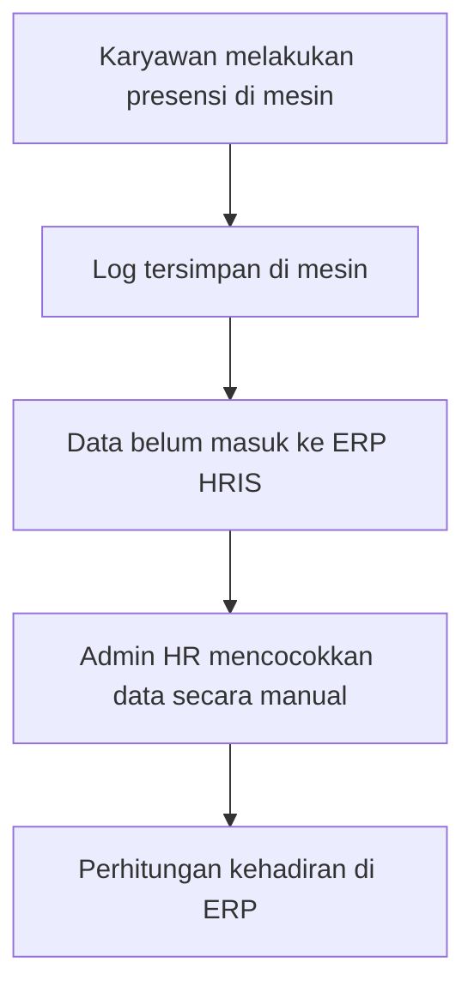
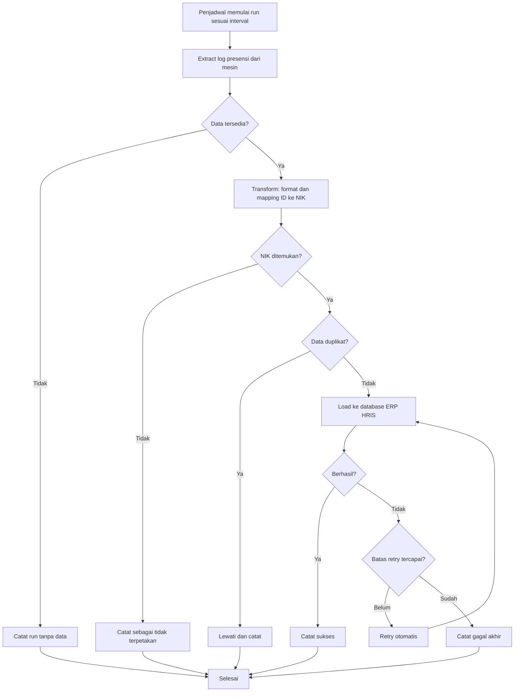
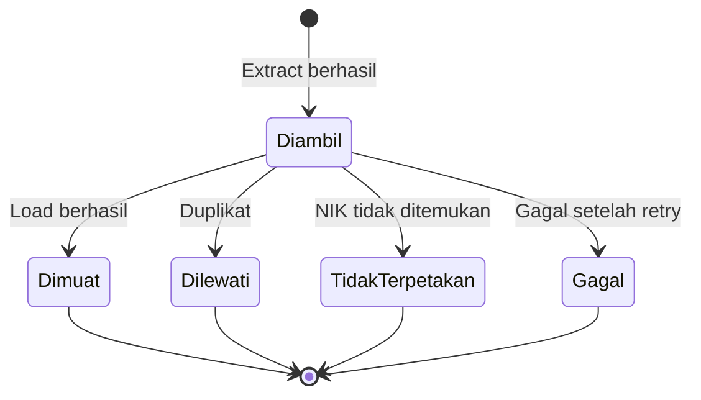

# Service ETL
## Sinkronisasi Log Presensi Face Recognition ke ERP HRIS

---

## 1. Informasi Dokumen

| Atribut | Keterangan |
|---|---|
| Nama Dokumen | BRD Service ETL Sinkronisasi Presensi |
| Versi | 1 |
| Tanggal | 13 November 2026 |
| Penyusun | @septian.narsa |
| Status | Public |

---

## 2. Ringkasan Eksekutif

Klien memiliki mesin face recognition untuk presensi dan sistem ERP HRIS. Data presensi dari mesin tidak terhubung dengan ERP, sehingga data kedua sistem tidak sinkron. Dokumen ini mengusulkan service ETL (Extract, Transform, Load) yang berjalan otomatis pada interval yang dapat diatur, misalnya setiap 5 menit atau 10 menit. Service mengambil log presensi dari mesin, memetakan ID karyawan ke NIK, lalu memuat data langsung ke database ERP HRIS. Perhitungan terlambat, lembur, dan absen tetap dilakukan oleh ERP setelah data masuk.

Service di-deploy di sisi klien, dan klien menjadi pemilik service setelah go-live. **[Usulan]**

---

## 3. Latar Belakang dan Permasalahan

### 3.1 Latar Belakang

Presensi karyawan dicatat oleh mesin face recognition, sedangkan pengolahan data kepegawaian dan perhitungan kehadiran dilakukan di ERP HRIS. Kedua sistem belum terhubung. **[Usulan]**

### 3.2 Permasalahan

| No | Permasalahan | Dampak Bisnis |
|---|---|---|
| P1 | Data log presensi di mesin tidak masuk ke ERP HRIS secara otomatis | Data presensi di dua sistem tidak sinkron |
| P2 | Ketidaksinkronan memerlukan pengecekan dan penyesuaian data secara manual **[Usulan]** | Waktu admin HR terserap untuk rekonsiliasi **[Usulan]** |
| P3 | Perhitungan terlambat, lembur, dan absen di ERP bergantung pada data presensi yang lengkap | Hasil perhitungan kehadiran berpotensi tidak akurat **[Usulan]** |
| P4 | Belum ada mekanisme yang memantau keberhasilan pengiriman data presensi | Kegagalan sinkronisasi sulit terdeteksi **[Usulan]** |
| P5 | Identitas karyawan di mesin dan ERP belum memiliki acuan yang seragam | Data presensi sulit dipetakan ke karyawan yang benar **[Usulan]** |

---

## 4. Tujuan Bisnis dan Indikator Keberhasilan

### 4.1 Tujuan Bisnis

| ID | Tujuan |
|---|---|
| BO-01 | Data log presensi dari mesin masuk ke ERP HRIS secara otomatis |
| BO-02 | Data presensi di mesin dan ERP sinkron sesuai interval yang ditetapkan |
| BO-03 | Mengurangi pekerjaan manual rekonsiliasi data presensi |
| BO-04 | Kegagalan sinkronisasi terdeteksi dan tercatat di log |

### 4.2 Indikator Keberhasilan (KPI)

1. Sinkronisasi berjalan sesuai interval yang diatur.
2. Log merekam data yang gagal disinkronkan.
3. Pekerjaan rekonsiliasi presensi akan full otomatis.

---

## 5. Ruang Lingkup

### 5.1 Dalam Lingkup (In Scope)

| No | Modul | Keterangan |
|---|---|---|
| 1 | Penjadwal | Menjalankan service otomatis dengan interval yang dapat diatur (contoh: 5 atau 10 menit) |
| 2 | Extract | Mengambil log presensi dari mesin face recognition |
| 3 | Transform | Memetakan ID karyawan di mesin ke NIK, memformat data, dan menyaring data ganda |
| 4 | Load | Memuat data presensi langsung ke database ERP HRIS |
| 5 | Retry | Mengulang proses secara otomatis jika gagal |
| 6 | Logging | Mencatat setiap run, data yang berhasil, dan data yang gagal |

### 5.2 Di Luar Lingkup (Out of Scope)

| Item | Catatan |
|---|---|
| Sinkronisasi dua arah (ERP ke mesin) | Arah data hanya dari mesin ke ERP **[Usulan]** |
| Sinkronisasi data master karyawan | Hanya log presensi yang disinkronkan **[Usulan]** |
| Sinkronisasi jadwal shift, cuti, dan izin | Tidak termasuk dalam lingkup **[Usulan]** |
| Perhitungan terlambat, lembur, dan absen | Dilakukan oleh ERP setelah data masuk **[Usulan]** |
| Pengelolaan enrolment wajah | Di luar lingkup service **[Usulan]** |
| Dashboard pemantauan visual | Pemantauan melalui log **[Usulan]** |

---

## 6. Stakeholder dan Aktor

| Aktor | Organisasi | Peran |
|---|---|---|
| Admin HR Klien | Klien | Pengguna ERP HRIS dan pemantau hasil presensi |
| Tim IT Klien | Klien | Pemilik service setelah go-live, pengelola server dan database |
| Tim Pengembang ETL | Penyedia | Pengembang dan penguji service, pendukung setelah go-live **[Usulan]** |
| Vendor Mesin Face Recognition | Pihak ketiga | Penyedia sumber data log presensi **[Usulan]** |
| Karyawan | Klien | Melakukan presensi |
| Sistem ETL | Sistem | Menjalankan proses extract, transform, dan load |
| ERP HRIS | Sistem | Menyimpan data presensi dan menghitung kehadiran |

---

## 7. Proses Bisnis

### 7.1 Proses As-Is

| Langkah | Aktor | Aktivitas |
|---|---|---|
| 1 | Karyawan | Melakukan presensi di mesin face recognition |
| 2 | Mesin | Menyimpan log presensi |
| 3 | Admin HR | Mencocokkan data secara manual **[Usulan]** |
| 4 | ERP HRIS | Menghitung kehadiran berdasarkan data yang tersedia |

### 7.2 Proses To-Be

### 7.3 Perbandingan As-Is dan To-Be

| Aspek | As-Is | To-Be |
|---|---|---|
| Pengiriman data | Manual **[Usulan]** | Otomatis sesuai interval |
| Pemetaan karyawan | Manual **[Usulan]** | Otomatis melalui NIK |
| Data ganda | Tidak terdeteksi otomatis **[Usulan]** | Dilewati dan dicatat |
| Kegagalan | Sulit dideteksi **[Usulan]** | Retry otomatis dan dicatat di log |
| Pemantauan | Tidak tersedia **[Usulan]** | Melalui log run |

---

## 8. Aturan Bisnis

Seluruh aturan bersifat **[Usulan]**.

### 8.1 Aturan Penjadwal

| ID | Aturan |
|---|---|
| BR-SC-01 | Interval sinkronisasi dapat diatur, misalnya 5 atau 10 menit |
| BR-SC-02 | Run berikutnya tidak dimulai jika run sebelumnya masih berjalan |
| BR-SC-03 | Interval diatur oleh tim IT klien tanpa perlu perubahan kode |

### 8.2 Aturan Extract

| ID | Aturan |
|---|---|
| BR-EX-01 | Extract hanya mengambil log presensi baru sejak run sukses terakhir |
| BR-EX-02 | Setiap log memuat ID karyawan di mesin, waktu presensi, dan jenis presensi |

### 8.3 Aturan Transform

| ID | Aturan |
|---|---|
| BR-TR-01 | ID karyawan di mesin dipetakan ke NIK di ERP HRIS |
| BR-TR-02 | Log yang tidak memiliki NIK yang cocok tidak dimuat ke ERP dan dicatat |
| BR-TR-03 | Format waktu dan jenis presensi disesuaikan dengan struktur ERP |
| BR-TR-04 | Perhitungan terlambat, lembur, dan absen tidak dilakukan oleh service ETL |

### 8.4 Aturan Load

| ID | Aturan |
|---|---|
| BR-LD-01 | Data dimuat langsung ke database ERP HRIS |
| BR-LD-02 | Log yang sudah ada di ERP tidak dimuat ulang |
| BR-LD-03 | Pemuatan dilakukan dalam satu transaksi per batch agar konsisten **[Usulan]** |

### 8.5 Aturan Retry dan Logging

| ID | Aturan |
|---|---|
| BR-RT-01 | Kegagalan load diulang secara otomatis hingga batas retry yang ditetapkan **[Usulan]** |
| BR-RT-02 | Jeda antar retry meningkat secara bertahap **[Usulan]** |
| BR-LG-01 | Setiap run mencatat waktu mulai, waktu selesai, jumlah data diproses, berhasil, gagal, dan dilewati |
| BR-LG-02 | Setiap log yang gagal dicatat beserta alasan dan ID karyawan di mesin |

---

## 9. Kebutuhan Bisnis

Prioritas memakai skala MoSCoW. Seluruh prioritas bersifat **[Usulan]**.

### 9.1 Modul Penjadwal

| ID | Kebutuhan | Aktor | Prioritas |
|---|---|---|---|
| REQ-SC-01 | Service berjalan otomatis sesuai interval yang diatur | Sistem | M |
| REQ-SC-02 | Interval dapat diubah melalui konfigurasi | Admin IT Klien | M |

### 9.2 Modul Extract

| ID | Kebutuhan | Aktor | Prioritas |
|---|---|---|---|
| REQ-EX-01 | Sistem mengambil log presensi baru dari mesin face recognition | Sistem | M |
| REQ-EX-02 | Sistem mencatat titik terakhir data yang sudah diambil | Sistem | M |

### 9.3 Modul Transform

| ID | Kebutuhan | Aktor | Prioritas |
|---|---|---|---|
| REQ-TR-01 | Sistem memetakan ID karyawan di mesin ke NIK | Sistem | M |
| REQ-TR-02 | Sistem menyaring log yang tidak memiliki NIK yang cocok | Sistem | M |
| REQ-TR-03 | Sistem menyesuaikan format data dengan struktur ERP | Sistem | M |

### 9.4 Modul Load

| ID | Kebutuhan | Aktor | Prioritas |
|---|---|---|---|
| REQ-LD-01 | Sistem memuat log presensi ke database ERP HRIS | Sistem | M |
| REQ-LD-02 | Sistem mencegah log ganda masuk ke ERP | Sistem | M |

### 9.5 Modul Retry

| ID | Kebutuhan | Aktor | Prioritas |
|---|---|---|---|
| REQ-RT-01 | Sistem mengulang proses load secara otomatis saat gagal | Sistem | M |
| REQ-RT-02 | Sistem mencatat kegagalan akhir setelah batas retry tercapai | Sistem | M |

### 9.6 Modul Logging dan Pemantauan

| ID | Kebutuhan | Aktor | Prioritas |
|---|---|---|---|
| REQ-LG-01 | Sistem mencatat setiap run beserta ringkasan hasilnya | Admin IT Klien | M |
| REQ-LG-02 | Sistem mencatat detail log yang gagal atau dilewati | Admin IT Klien | M |
| REQ-LG-03 | Admin IT Klien dapat melihat riwayat run untuk pemantauan | Admin IT Klien | S |

### 9.7 Modul Konfigurasi dan Deployment

| ID | Kebutuhan | Aktor | Prioritas |
|---|---|---|---|
| REQ-CF-01 | Koneksi ke mesin dan database ERP dapat diatur tanpa perubahan kode | Admin IT Klien | M |
| REQ-CF-02 | Service dideploy di server klien | Tim Pengembang | M |

---

## 10. Siklus Status

### 10.1 Status Run

| Status | Arti | Pemicu |
|---|---|---|
| Berjalan | Run sedang memproses data | Penjadwal memulai run |
| Sukses | Semua data berhasil diproses | Tidak ada kegagalan akhir |
| Sebagian | Sebagian data gagal atau dilewati | Ada log tidak terpetakan atau gagal akhir |
| Gagal | Run tidak berhasil memuat data | Gagal setelah batas retry |
| Tanpa Data | Tidak ada log baru | Extract tidak menemukan data baru |

### 10.2 Status Log Presensi

| Status | Arti | Pemicu |
|---|---|---|
| Diambil | Log sudah diekstrak | Extract berhasil |
| Dimuat | Log sudah masuk ERP | Load berhasil |
| Dilewati | Log ganda atau sudah ada di ERP | Pengecekan duplikat |
| Tidak Terpetakan | Log tanpa NIK yang cocok | Pemetaan gagal |
| Gagal | Log gagal dimuat setelah retry | Batas retry tercapai |

### 10.3 Diagram Transisi Status Log

---

## 11. Kebutuhan Data

### 11.1 Entitas

| Entitas | Keterangan |
|---|---|
| Log Presensi Mesin | Data mentah dari mesin face recognition |
| Pemetaan Karyawan | Hubungan ID karyawan di mesin dengan NIK |
| Run Sinkronisasi | Catatan setiap run service |
| Log Error | Catatan data yang gagal atau dilewati |
| Data Presensi ERP | Tabel tujuan di database ERP HRIS **[Usulan]** |

### 11.2 Struktur Tabel Usulan

**sync_run_log** [Usulan]

| Kolom | Tipe | Keterangan |
|---|---|---|
| run_id | integer | PRIMARY KEY |
| started_at | timestamp | Waktu mulai run |
| finished_at | timestamp | Waktu selesai run |
| status | varchar | Berjalan, Sukses, Sebagian, Gagal, Tanpa Data |
| total_read | integer | Jumlah log dibaca |
| total_loaded | integer | Jumlah log dimuat |
| total_skipped | integer | Jumlah log dilewati |
| total_failed | integer | Jumlah log gagal |

**sync_error_log** [Usulan]

| Kolom | Tipe | Keterangan |
|---|---|---|
| error_id | integer | PRIMARY KEY |
| run_id | integer | FOREIGN KEY ke sync_run_log |
| machine_emp_id | varchar | ID karyawan di mesin |
| punch_time | timestamp | Waktu presensi |
| error_code | varchar | Mengikuti Lampiran A |
| error_message | varchar | Keterangan kesalahan |
| retry_count | integer | Jumlah retry |
| created_at | timestamp | DEFAULT CURRENT_TIMESTAMP |

**employee_mapping** [Usulan]

| Kolom | Tipe | Keterangan |
|---|---|---|
| machine_emp_id | varchar | ID karyawan di mesin |
| nik | varchar | NIK karyawan di ERP HRIS |
| is_active | boolean | Status pemetaan |

### 11.3 Ketetapan Data

- NIK dari ERP HRIS menjadi acuan identitas karyawan **[Usulan]**.
- Log presensi dianggap sama jika memiliki NIK, waktu presensi, dan jenis presensi yang sama **[Usulan]**.
- Nama tabel tujuan di ERP dan struktur kolomnya ditetapkan saat desain teknis **[Usulan]**.
- Data presensi yang sudah dimuat tidak diubah oleh service ETL **[Usulan]**.

---

## 12. Kebutuhan Non-Fungsional

| ID | Kategori | Kebutuhan |
|---|---|---|
| NFR-01 | Kinerja | Satu run selesai sebelum run berikutnya dijadwalkan **[Usulan]** |
| NFR-02 | Kinerja | Satu run memproses jumlah log yang sesuai volume harian klien **[Usulan]** |
| NFR-03 | Keandalan | Retry otomatis dengan jeda bertahap dan batas maksimum **[Usulan]** |
| NFR-04 | Keandalan | Proses load bersifat idempotent, sehingga retry tidak menghasilkan data ganda **[Usulan]** |
| NFR-05 | Ketersediaan | Service berjalan selama server klien aktif **[Usulan]** |
| NFR-06 | Keamanan | Kredensial mesin dan database disimpan terenkripsi di server klien **[Usulan]** |
| NFR-07 | Keamanan | Akses database menggunakan akun dengan hak terbatas **[Usulan]** |
| NFR-08 | Auditabilitas | Log run dan log error disimpan minimal sesuai kebijakan klien **[Usulan]** |
| NFR-09 | Pemeliharaan | Konfigurasi dipisahkan dari kode program **[Usulan]** |

---

## 13. Asumsi, Batasan, dan Dependensi

### 13.1 Asumsi

1. Mesin face recognition menyediakan data log presensi yang dapat diakses oleh service **[Usulan]**.
2. ID karyawan di mesin dapat dipetakan ke NIK di ERP HRIS **[Usulan]**.
3. Database ERP HRIS dapat diakses langsung dari server klien **[Usulan]**.
4. Perhitungan kehadiran di ERP berjalan setelah data presensi masuk **[Usulan]**.

### 13.2 Batasan

1. Sinkronisasi hanya satu arah, dari mesin ke ERP **[Usulan]**.
2. Hanya log presensi yang disinkronkan **[Usulan]**.
3. Pemuatan langsung ke database ERP melewati lapisan aplikasi ERP, sehingga logika validasi ERP perlu dipastikan tetap berlaku **[Usulan]**.

### 13.3 Dependensi

| Dependensi | Keterangan |
|---|---|
| Mesin face recognition | Sumber data log presensi |
| Database ERP HRIS | Tujuan pemuatan data |
| Server klien | Tempat deployment service |
| Jaringan internal | Koneksi antara server, mesin, dan database |
| Tim IT Klien | Pemilik dan pengelola service setelah go-live |

---

## 14. Risiko dan Mitigasi

| ID | Risiko | Dampak | Mitigasi |
|---|---|---|---|
| R1 | Retry menghasilkan data ganda di ERP | Perhitungan kehadiran salah | Pengecekan duplikat dan proses load idempotent **[Usulan]** |
| R2 | ID karyawan di mesin tidak cocok dengan NIK | Data presensi tidak termuat | Pencatatan log tidak terpetakan dan pemeliharaan tabel pemetaan **[Usulan]** |
| R3 | Struktur database ERP berubah setelah deployment | Load gagal | Dokumentasi struktur tabel dan prosedur perubahan bersama tim IT klien **[Usulan]** |
| R4 | Load langsung ke database melewati validasi ERP | Data tidak konsisten dengan aturan ERP | Validasi data di ETL dan pengujian bersama tim ERP **[Usulan]** |
| R5 | Mesin tidak dapat diakses | Data tertunda | Retry otomatis dan pencatatan kegagalan **[Usulan]** |
| R6 | Volume log meningkat | Run melebihi interval | Pemantauan durasi run dan penyesuaian interval **[Usulan]** |
| R7 | Pemilik pasca go-live belum siap mengelola | Service tidak terpantau | Dokumentasi operasional dan pelatihan tim IT klien **[Usulan]** |

---

## 15. Traceability: Tujuan ke Kebutuhan

Belum ada user story untuk proyek ini. Traceability dibuat dari tujuan bisnis ke kebutuhan.

| Tujuan | Kebutuhan Terkait |
|---|---|
| BO-01 Data masuk otomatis | REQ-SC-01, REQ-EX-01, REQ-LD-01 |
| BO-02 Sinkron sesuai interval | REQ-SC-02, REQ-EX-02, REQ-CF-01 |
| BO-03 Kurangi rekonsiliasi manual | REQ-TR-01, REQ-TR-02, REQ-LD-02 |
| BO-04 Kegagalan terdeteksi | REQ-RT-01, REQ-RT-02, REQ-LG-01, REQ-LG-02, REQ-LG-03 |

---

## 16. Glosarium dan Langkah Selanjutnya

### 16.1 Glosarium

| Istilah | Arti |
|---|---|
| ETL | Extract, Transform, Load: proses mengambil, mengolah, dan memuat data |
| ERP HRIS | Sistem perencanaan sumber daya dan informasi kepegawaian |
| NIK | Nomor Induk Karyawan |
| Log Presensi | Catatan waktu masuk dan keluar dari mesin |
| Idempotent | Proses yang menghasilkan hasil sama meski dijalankan ulang |
| Retry | Pengulangan otomatis saat proses gagal |

### 16.2 Langkah Selanjutnya

1. Konfirmasi merek dan model mesin face recognition serta metode aksesnya.
2. Konfirmasi versi ERP HRIS dan nama tabel tujuan presensi.
3. Tetapkan batas retry, jeda retry, dan nilai interval default.
4. Tetapkan aturan pemetaan ID karyawan ke NIK, termasuk data yang tidak memiliki NIK.
5. Tetapkan lokasi penyimpanan log dan masa retensinya.
6. Tetapkan serah terima operasional kepada tim IT klien setelah go-live.
7. Review BRD bersama stakeholder dan perbarui ke versi 0.2.

---

## 17. Lampiran

### Lampiran A. Kode Error dan Status [Usulan]

| Kode | Tahap | Keterangan |
|---|---|---|
| EX_ERR_CONN | Extract | Gagal terhubung ke mesin |
| EX_EMPTY | Extract | Tidak ada log baru |
| TR_NIK_NOT_FOUND | Transform | ID karyawan tidak memiliki NIK |
| TR_FORMAT_INVALID | Transform | Format data tidak sesuai |
| TR_DUPLICATE | Transform | Log sudah ada di ERP |
| LD_ERR_DB | Load | Gagal menulis ke database ERP |
| LD_RETRY_EXHAUSTED | Load | Batas retry tercapai |
