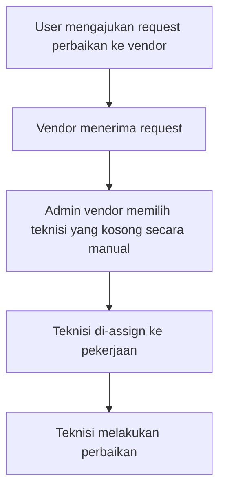
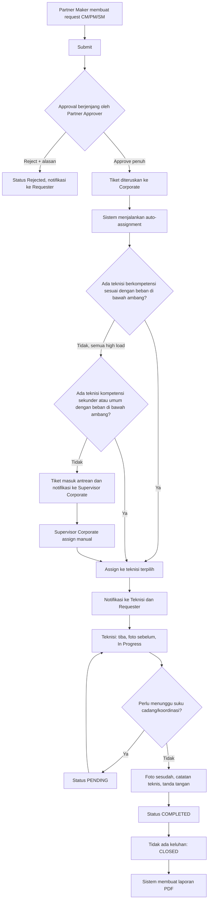
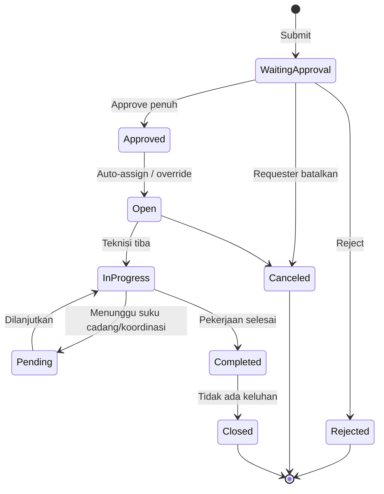

# Service Desk
## BRD Service Desk — Ticketing, Register Asset, dan Penugasan Teknisi Otomatis

| Atribut | Keterangan |
|---|---|
| Nama Dokumen | BRD Service Desk |
| Versi | 0.2 (Draft) |
| Tanggal | 12 November 2026 |
| Penyusun | @septian.narsa |
| Status | Approved |

**Riwayat Revisi**

| Versi | Tanggal | Perubahan |
|---|---|---|
| 0.1 | 12 Nov 2026 | Draft awal |
| 0.2 | 12 Nov 2026 | Menerapkan hasil review: status tiket, aturan penugasan, template laporan, standar log aktivitas, penagihan di luar platform |

---

## 1. Ringkasan Eksekutif

Service Desk adalah sistem yang menghubungkan **Partner** (pihak yang membutuhkan layanan perbaikan/perawatan) dengan **Corporate** (pihak yang menyediakan layanan dan teknisi). Saat ini penugasan teknisi dilakukan **secara manual** oleh vendor/admin, sehingga bergantung pada kemampuan admin mengetahui teknisi mana yang sedang kosong.

Proyek ini bertujuan membangun proses end-to-end berbasis aplikasi (mobile dan web) yang mencakup pendaftaran aset, pembuatan tiket oleh Partner dengan approval berjenjang, **penugasan teknisi otomatis** berdasarkan kompetensi, jumlah tiket, dan prioritas, pelaksanaan pekerjaan oleh teknisi, serta pelaporan per tiket yang menjadi dasar penagihan di luar platform.

Perubahan utama dari kondisi saat ini: **langkah assign teknisi manual dihapus dan digantikan penugasan otomatis oleh sistem**, dengan pengecualian ditangani Supervisor Corporate.

---

## 2. Latar Belakang dan Permasalahan

### 2.1 Latar Belakang

Partner membutuhkan dukungan teknis untuk aset operasional (contoh: server, mesin ATM, perangkat jaringan, power supply). Dukungan diberikan oleh teknisi yang tersebar di berbagai lokasi dengan kompetensi berbeda.

### 2.2 Permasalahan Kondisi Saat Ini (As-Is)

| No | Permasalahan | Dampak Bisnis |
|---|---|---|
| P1 | Penugasan teknisi dilakukan manual oleh vendor/admin | Waktu respons lambat, tergantung ketersediaan admin |
| P2 | Pemilihan teknisi bertumpu pada pengetahuan admin tentang teknisi yang kosong | Distribusi beban tidak merata, risiko salah assign |
| P3 | Tidak ada pelacakan terstruktur atas kedatangan, mulai kerja, dan selesai kerja | Sulit mengukur SLA dan durasi pekerjaan |
| P4 | Dokumentasi pekerjaan (foto, tanda tangan, catatan) tidak terstandar | Bukti pekerjaan lemah, sulit diaudit |
| P5 | Partner kurang visibilitas status request | Banyak follow-up manual ke vendor |
| P6 | Data aset tidak terpusat dan tidak terklasifikasi | Riwayat perawatan sulit dilacak |

---

## 3. Tujuan Bisnis dan Indikator Keberhasilan

### 3.1 Tujuan Bisnis

| ID | Tujuan |
|---|---|
| BO-01 | Mempercepat waktu dari tiket disetujui sampai teknisi ditugaskan dengan menghilangkan assign manual |
| BO-02 | Menyeimbangkan beban kerja teknisi berdasarkan jumlah tiket dan prioritas |
| BO-03 | Memastikan tiket ditangani teknisi dengan kompetensi yang sesuai |
| BO-04 | Menyediakan transparansi status tiket bagi Partner dan Corporate secara real-time |
| BO-05 | Menyediakan bukti pekerjaan dan laporan yang terstandar |
| BO-06 | Menyediakan data aset terpusat beserta riwayat perawatan |
| BO-07 | Menghasilkan report per tiket yang menjadi dasar penagihan ke client |

### 3.2 Indikator Keberhasilan (KPI)

Target angka di bawah merupakan **[Usulan]** dan perlu disepakati dengan stakeholder.

| KPI | Definisi | Target |
|---|---|---|
| Waktu penugasan | Waktu dari tiket full-approved sampai teknisi ter-assign | ≤ 5 menit |
| Persentase tiket auto-assign | Tiket yang ter-assign otomatis tanpa intervensi manual | ≥ 90% |
| Distribusi beban | Selisih beban kerja antar teknisi sekompetensi | Dalam rentang ambang beban |
| Kepatuhan dokumentasi | Tiket closed dengan foto sebelum/sesudah dan tanda tangan/foto bukti | 100% |
| Tingkat eskalasi/penggantian teknisi | Tiket yang butuh re-assign | Dipantau (baseline dikumpulkan) |

---

## 4. Ruang Lingkup

### 4.1 Dalam Lingkup (In Scope)

1. **Register Asset** (web, dan mobile): pendaftaran, edit, pencarian, approval aset, parameter kategori.
2. **Ticketing Partner** (mobile dan web): pembuatan request CM/PM/SM, matrix problem, approval berjenjang, notifikasi, riwayat, pembatalan.
3. **Penugasan teknisi otomatis**: berdasarkan kompetensi, jumlah tiket, prioritas, dan lokasi/rute.
4. **Ticketing Technician** (mobile): daftar tiket, pencatatan aktivitas, foto, tanda tangan, status, eskalasi, ketidakhadiran.
5. **Pelaporan**: laporan pekerjaan teknisi (PDF, template standar), report per tiket untuk penagihan, dan log aktivitas standar.
6. **Dashboard** monitoring tiket untuk Admin/Supervisor Corporate (web).
7. **Notifikasi** lintas aktor.

### 4.2 Di Luar Lingkup (Out of Scope)

| Item | Catatan |
|---|---|
| Integrasi absensi/jadwal kerja teknisi | Ketersediaan awal dihitung dari data tiket aktif |
| Modul tagihan dan pembayaran | Penagihan per tiket dilakukan di luar platform; platform hanya menghasilkan report yang dikirim ke client |
| Manajemen stok suku cadang | Hanya status PENDING karena menunggu suku cadang |
| Modul HR/penilaian kinerja teknisi | Tidak termasuk dalam fitur yang dibangun |

---

## 5. Stakeholder dan Aktor

| Aktor | Organisasi | Peran |
|---|---|---|
| Staff Maker Partner (Requester) | Partner | Membuat request support dan mendaftarkan aset |
| Staff Approval Partner (SPV/Manager) | Partner | Approve/reject request dan pendaftaran aset secara berjenjang |
| Admin Partner | Partner | Mengelola aset Partner |
| Supervisor Corporate | Corporate | Monitoring, menangani eskalasi, mencari teknisi pengganti/tambahan, mengubah jadwal kunjungan |
| Admin Corporate | Corporate | Dashboard monitoring, mengelola parameter (matrix problem, kategori aset), melihat aset |
| Teknisi | Corporate | Menangani tiket, mencatat aktivitas, membuat laporan |
| Sistem (Auto-Assignment Engine) | Service Desk | Menugaskan teknisi otomatis |


---

## 6. Proses Bisnis

### 6.1 Proses As-Is (Manual)



| Langkah | Aktor | Aktivitas |
|---|---|---|
| 1 | User | Mengajukan request perbaikan ke vendor |
| 2 | Vendor (admin) | Menerima request dan meng-assign teknisi yang kosong secara manual |
| 3 | Teknisi | Melakukan perbaikan |

### 6.2 Proses To-Be (Otomatis)



### 6.3 Perbandingan As-Is dan To-Be

| Aspek | As-Is | To-Be |
|---|---|---|
| Pengajuan | User ke vendor | Partner via mobile dengan data terstruktur (matrix problem, asset ID, prioritas) |
| Validasi | Tidak terstruktur | Approval berjenjang di sisi Partner |
| Penugasan teknisi | Manual oleh admin vendor | **Otomatis oleh sistem** |
| Dasar pemilihan | Teknisi yang kosong (penilaian admin) | Kompetensi, jumlah tiket, dan prioritas |
| Peran admin/supervisor | Eksekutor penugasan | Pengawas dan penangan pengecualian/eskalasi |
| Pelacakan pekerjaan | Tidak terstandar | Log aktivitas ber-timestamp, foto, tanda tangan |
| Pelaporan | Tidak terstandar | Laporan PDF otomatis dengan template ringkas, serta report per tiket untuk penagihan |

---

## 7. Aturan Bisnis (Business Rules)

### 7.1 Aturan Penugasan Teknisi Otomatis

| ID | Aturan |
|---|---|
| BR-AS-01 | Penugasan hanya dipicu setelah tiket **full approved** oleh seluruh level approver Partner |
| BR-AS-02 | **Kompetensi menjadi syarat utama.** Kandidat teknisi pertama adalah teknisi yang kompetensinya sesuai dengan matrix problem tiket |
| BR-AS-03 | Dari kandidat berkompetensi sesuai, sistem memilih teknisi dengan **beban kerja terendah**. Beban kerja diukur dari **jumlah tiket aktif dan tingkat prioritas tiket** |
| BR-AS-04 | Jika seluruh teknisi berkompetensi sesuai berada pada kondisi **high load** (beban melewati ambang batas), tiket **dapat dialihkan ke teknisi lain** di luar kompetensi utama |
| BR-AS-05 | Teknisi pengganti pada BR-AS-04 dipilih dari teknisi berkompetensi sekunder atau umum. Selama berstatus teknisi, yang bersangkutan dapat ditugaskan; sistem memilih yang bebannya terendah dan masih di bawah ambang |
| BR-AS-06 | Tiket berprioritas **Urgent** dicarikan lebih dulu ke **teknisi khusus Urgent** yang sedang kosong |
| BR-AS-07 | Jika tidak ada teknisi khusus Urgent yang kosong, sistem mencari teknisi yang pekerjaannya searah/dekat dengan lokasi tiket |
| BR-AS-08 | Untuk tiket noNUrgent, penugasan juga mempertimbangkan lokasi dan rute pekerjaan teknisi, setelah syarat kompetensi dan batas beban terpenuhi |
| BR-AS-09 | Jika tidak ada kandidat sama sekali, tiket masuk antrean dan sistem memberi notifikasi ke Supervisor Corporate untuk assign manual |
| BR-AS-10 | Supervisor Corporate dapat melakukan **override/re-assign manual** pada kasus eskalasi atau teknisi berhalangan |
| BR-AS-11 | Penentuan hari kerja mengabaikan hari libur pada penjadwalan CM |
| BR-AS-12 | Setiap penugasan (otomatis atau manual) dicatat dalam log beserta alasan pemilihan |
| BR-AS-13 | Parameter "maksimum teknisi di-assign tiket per hari" digantikan oleh ambang beban (Bagian 7.2) |
| BR-AS-14 | Ketersediaan teknisi dihitung dari data tiket aktif |

### 7.2 Model Beban Kerja

Pengukuran beban memakai dua variabel yang sudah diputuskan: **jumlah tiket** dan **tingkat prioritas**. 

| Prioritas | Bobot Beban |
|---|---|
| Low | 1 |
| Medium | 2 |
| High | 3 |
| Urgent | 5 |

- **Skor beban teknisi** = jumlah bobot seluruh tiket aktif (status Open, In Progress, Pending) pada periode yang dihitung.
- **Ambang high load** = parameter yang dapat diatur Admin Corporate (nilai awal ditetapkan saat konfigurasi).
- Contoh: teknisi memegang 1 tiket High (3) dan 2 tiket Low (2) memiliki skor 5. Jika ambang = 8, teknisi masih dapat menerima tiket baru.


### 7.3 Aturan Request dan Approval

| ID | Aturan |
|---|---|
| BR-RQ-01 | Terdapat tiga jenis request: **CM** (insiden mendadak), **PM** (perawatan rutin berulang), **SM** (bantuan khusus terjadwal dalam rentang waktu tertentu) |
| BR-RQ-02 | Tanggal pembuatan tiket dibuat otomatis oleh sistem (dd/mm/yyyy HH:mm:ss) |
| BR-RQ-03 | Level prioritas: Low, Medium, High, Urgent |
| BR-RQ-04 | Matrix problem wajib diisi (kategori dan detail), bersumber dari parameter yang dikelola Admin Corporate |
| BR-RQ-05 | Approval bersifat **multilevel/berjenjang** (staff diapprove SPV, SPV diapprove manager) |
| BR-RQ-06 | Reject wajib disertai alasan; tiket yang ditolak berstatus **Rejected** |
| BR-RQ-07 | Requester dapat mengubah request **selama belum full approved** |
| BR-RQ-08 | Requester dapat membatalkan request (status **Canceled**) selama tidak melewati batas maksimal parameter. Canceled berbeda dari Rejected |
| BR-RQ-09 | PM berulang otomatis sesuai periode yang diinput Partner |

### 7.4 Aturan Pelaksanaan Pekerjaan Teknisi

| ID | Aturan |
|---|---|
| BR-TK-01 | Teknisi menangani tiket sesuai urutan paling urgent |
| BR-TK-02 | Saat tiba di lokasi, teknisi mencatat kedatangan dan status berubah menjadi **In Progress** |
| BR-TK-03 | Foto **sebelum** pekerjaan wajib diambil |
| BR-TK-04 | Jika Asset ID di lapangan berbeda, teknisi dapat menginput informasi aset sebenarnya |
| BR-TK-05 | Status **PENDING** dipakai bila menunggu suku cadang atau hasil koordinasi |
| BR-TK-06 | Foto **sesudah** pekerjaan (lampiran bukti) wajib diunggah saat pekerjaan selesai |
| BR-TK-07 | Teknisi mengisi catatan teknis, membuat/upload tanda tangan, dan meminta tanda tangan PIC lokasi; bila tidak memungkinkan diganti foto dokumentasi |
| BR-TK-08 | Setelah **COMPLETED**, tiket menjadi **CLOSED** bila tidak ada keluhan |
| BR-TK-09 | Teknisi berhalangan hadir wajib memberi tahu Supervisor Corporate melalui aplikasi |
| BR-TK-10 | Teknisi dapat melakukan eskalasi ke Supervisor Corporate. Supervisor Corporate yang memutuskan teknisi pengganti atau tambahan dan memperbarui jadwal kunjungan |
| BR-TK-11 | Seluruh teknisi yang ter-assign pada tiket ditampilkan pada detail request |

### 7.5 Aturan Register Asset

| ID | Aturan |
|---|---|
| BR-AT-01 | Pendaftaran aset oleh Partner Maker wajib disetujui Partner Supervisor sebelum aset terdaftar |
| BR-AT-02 | Field Partner otomatis terisi sesuai akun Partner |
| BR-AT-03 | Edit aset oleh Partner juga masuk proses approval |
| BR-AT-04 | Corporate hanya memiliki akses **lihat** terhadap aset |
| BR-AT-05 | Kategori aset dikelola melalui menu Manajemen Parameter dan dipakai sebagai dropdown |
| BR-AT-06 | Lokasi aset belum tentu di kantor; pin point lokasi wajib |

### 7.6 Aturan Rentang Waktu Pengerjaan per Tipe Tiket

| Tipe | Pengisi Rentang Waktu | Aturan | Acuan |
|---|---|---|---|
| CM | Sistem | Dijadwalkan otomatis saat penugasan, mengabaikan hari libur, dibatasi ambang beban teknisi |
| SM | Requester | Requester mengisi rentang pengerjaan (tanggal mulai dan selesai) sesuai kebutuhan; sistem memeriksa ambang beban pada setiap hari dalam rentang |
| PM | Requester | Requester mengisi rentang waktu per bulan; tiket berulang otomatis sesuai periode yang diinput; sistem memeriksa ambang beban pada setiap jadwal |

`start_target_date` dan `end_target_date` berisi awal dan akhir rentang di atas. Untuk CM, nilainya diisi sistem saat penjadwalan.

---

## 8. Kebutuhan Bisnis (Business Requirements)

Prioritas memakai skala MoSCoW: **M**ust, **S**hould, **C**ould, **W**on't.

### 8.1 Modul Register Asset

| ID | Kebutuhan | Aktor | Prioritas |
|---|---|---|---|
| REQ-AT-01 | Sistem menyediakan pengelolaan parameter kategori aset (nama kategori wajib, deskripsi opsional) | Admin Corporate | M |
| REQ-AT-02 | Sistem memungkinkan Partner Maker menambah aset dengan data: foto, nama, kategori, nomor serial, Asset ID, merek, model, spesifikasi (wajib); potensi kerusakan, tanggal pembelian (opsional) | Partner Maker | M |
| REQ-AT-03 | Sistem menyediakan detail lokasi aset: provinsi, kabupaten/kota, kecamatan, kelurahan (dropdown berjenjang), kode pos, alamat lengkap, pin point peta/GPS | Partner Maker | M |
| REQ-AT-04 | Sistem menerapkan approval Partner Supervisor (setujui/tolak dengan catatan) sebelum aset terdaftar | Partner Supervisor | M |
| REQ-AT-05 | Sistem menyediakan daftar aset dengan pencarian dan filter (nama, kategori, status, lokasi) serta paginasi | Partner, Corporate | M |
| REQ-AT-06 | Sistem mendukung edit dan hapus aset oleh Partner melalui proses approval | Partner | S |
| REQ-AT-07 | Sistem menampilkan riwayat perawatan per aset | Partner, Corporate | S |
| REQ-AT-08 | Corporate hanya dapat melihat aset tanpa mengubah | Corporate | M |

### 8.2 Modul Ticketing Partner

| ID | Kebutuhan | Aktor | Prioritas |
|---|---|---|---|
| REQ-TP-01 | Sistem memungkinkan pembuatan request CM, PM, dan SM melalui mobile | Partner Maker | M |
| REQ-TP-02 | Form request memuat: tanggal otomatis, tipe tiket, matrix problem, prioritas, subject, deskripsi, Asset ID, lokasi aset/kantor, lokasi spesifik, rentang waktu rencana pengerjaan (diisi Requester untuk SM dan PM; dijadwalkan sistem untuk CM) | Partner Maker | M |
| REQ-TP-03 | Sistem menyediakan dropdown matrix problem (kategori dan detail) yang dikelola Admin Corporate | Admin Corporate, Partner Maker | M |
| REQ-TP-04 | Sistem menjalankan approval berjenjang dan mengirim notifikasi ke approver pada tiap level | Sistem, Approver | M |
| REQ-TP-05 | Approver dapat melihat daftar request yang perlu disetujui, menyetujui atau menolak dengan alasan | Partner Approver | M |
| REQ-TP-06 | Requester menerima notifikasi hasil approval beserta alasan penolakan | Requester | M |
| REQ-TP-07 | Requester dapat melihat riwayat dan melacak status request | Requester | M |
| REQ-TP-08 | Requester dapat mengubah request sebelum full approve dan membatalkan sesuai batas parameter | Requester | S |
| REQ-TP-09 | Sistem menjadwalkan PM berulang sesuai periode input | Sistem | M |

### 8.3 Modul Penugasan Teknisi Otomatis (Perubahan Utama)

| ID | Kebutuhan | Aktor | Prioritas |
|---|---|---|---|
| REQ-AS-01 | Sistem menugaskan teknisi otomatis setelah tiket full approved, tanpa intervensi admin | Sistem | M |
| REQ-AS-02 | Sistem memfilter kandidat berdasarkan kompetensi yang sesuai dengan matrix problem | Sistem | M |
| REQ-AS-03 | Sistem menghitung beban kerja teknisi dari jumlah tiket aktif dan bobot prioritas | Sistem | M |
| REQ-AS-04 | Sistem memilih teknisi dengan beban terendah di antara kandidat berkompetensi sesuai | Sistem | M |
| REQ-AS-05 | Bila teknisi berkompetensi sesuai high load, sistem mengalihkan tiket ke teknisi berkompetensi sekunder atau umum dengan beban terendah | Sistem | M |
| REQ-AS-06 | Sistem memprioritaskan teknisi khusus Urgent untuk tiket Urgent | Sistem | M |
| REQ-AS-07 | Admin Corporate dapat mengatur parameter: ambang high load, bobot prioritas, kompetensi teknisi (utama, sekunder, umum), dan daftar teknisi khusus Urgent | Admin Corporate | M |
| REQ-AS-08 | Sistem menempatkan tiket pada antrean dan memberi notifikasi ke Supervisor Corporate bila tidak ada kandidat tersedia | Sistem | M |
| REQ-AS-09 | Supervisor Corporate dapat melakukan override/re-assign manual dan menambah teknisi pendukung; keputusan teknisi pengganti atau tambahan ada pada Supervisor Corporate | Supervisor Corporate | M |
| REQ-AS-10 | Sistem mencatat log setiap penugasan beserta alasan (kompetensi, skor beban, aturan yang dipakai) | Sistem | S |
| REQ-AS-11 | Sistem mengirim notifikasi penugasan ke teknisi dan Requester | Sistem | M |
| REQ-AS-12 | Sistem mempertimbangkan lokasi/rute teknisi sebagai kriteria tambahan (BR-AS-07, BR-AS-08) | Sistem | S |

### 8.4 Modul Ticketing Technician

| ID | Kebutuhan | Aktor | Prioritas |
|---|---|---|---|
| REQ-TT-01 | Teknisi melihat daftar tiket yang ditugaskan, diurutkan berdasarkan prioritas, dengan info matrix problem, judul, prioritas, status, jadwal kunjungan | Teknisi | M |
| REQ-TT-02 | Teknisi melihat detail tiket (lokasi, detail insiden, prioritas) | Teknisi | M |
| REQ-TT-03 | Teknisi mencatat kedatangan dan mengubah status ke In Progress dengan timestamp | Teknisi | M |
| REQ-TT-04 | Teknisi mengambil foto sebelum dan sesudah pekerjaan | Teknisi | M |
| REQ-TT-05 | Teknisi dapat memperbarui informasi aset bila Asset ID berbeda dengan kondisi lapangan | Teknisi | S |
| REQ-TT-06 | Teknisi dapat mengubah status menjadi PENDING dengan alasan | Teknisi | M |
| REQ-TT-07 | Teknisi mengisi catatan teknis, tanda tangan teknisi, dan tanda tangan PIC (atau foto bukti) | Teknisi | M |
| REQ-TT-08 | Teknisi dapat memberi tahu Supervisor Corporate bila berhalangan | Teknisi | M |
| REQ-TT-09 | Teknisi dapat melakukan eskalasi pekerjaan ke Supervisor Corporate | Teknisi | M |
| REQ-TT-10 | Teknisi menyelesaikan pekerjaan (COMPLETED) dan sistem menutup tiket (CLOSED) | Teknisi, Sistem | M |

### 8.5 Notifikasi, Pelaporan, dan Dashboard

| ID | Kebutuhan | Aktor | Prioritas |
|---|---|---|---|
| REQ-NT-01 | Notifikasi ke teknisi saat tiket ditugaskan | Sistem | M |
| REQ-NT-02 | Notifikasi ke Requester saat tindakan tercatat pada tiketnya | Sistem | M |
| REQ-NT-03 | Notifikasi ke Approver saat persetujuan diperlukan | Sistem | M |
| REQ-NT-04 | Notifikasi ke Supervisor Corporate saat eskalasi, teknisi berhalangan, atau tidak ada kandidat | Sistem | M |
| REQ-RP-01 | Sistem membuat laporan pekerjaan otomatis saat tiket closed menggunakan template standar ringkas (Lampiran A) | Sistem | M |
| REQ-RP-02 | Laporan dapat diakses Requester dan diunduh dalam format PDF | Requester | M |
| REQ-RP-03 | Sistem menyimpan log aktivitas dengan struktur dan kode aksi standar (Lampiran B) | Sistem | M |
| REQ-RP-04 | Sistem menghasilkan report per tiket (tipe, level prioritas, aset, lokasi, waktu, durasi, status akhir) yang dapat difilter per periode dan Partner serta diekspor untuk dikirim ke client sebagai dasar penagihan. Proses penagihan dilakukan di luar platform | Admin Corporate | M |
| REQ-DB-01 | Dashboard web menampilkan seluruh request masuk beserta status | Admin/Supervisor Corporate | M |
| REQ-DB-02 | Dashboard menampilkan beban kerja dan ketersediaan teknisi | Supervisor Corporate | S |

---

## 9. Siklus Status Tiket

### 9.1 Status

| Status | Arti | Pemicu |
|---|---|---|
| Waiting Approval | Menunggu persetujuan approver Partner | Submit |
| Approved | Disetujui penuh | Approve level terakhir |
| Rejected | Ditolak Partner Approver | Reject + alasan |
| Open | Sudah ter-assign, menunggu pelaksanaan | Penugasan sistem/manual |
| In Progress | Teknisi bekerja | Teknisi tiba/mulai kerja |
| Pending | Tertunda (suku cadang/koordinasi) | Teknisi |
| Completed | Pekerjaan selesai | Teknisi |
| Canceled | Dibatalkan Requester | Requester membatalkan sesuai batas parameter |
| Closed | Tiket ditutup, laporan dibuat | Tidak ada keluhan |

> Tabel status ini menjadi acuan tunggal dan menggantikan daftar status pada FSD Partner dan FSD Technician. Status **Rejected** (ditolak approver) dan **Canceled** (dibatalkan Requester) dipisahkan.

### 9.2 Diagram Transisi



---

## 10. Kebutuhan Data


| Entitas | Keterangan |
|---|---|
| Ticket | Data request (tipe CM/PM/SM, prioritas, matrix problem, asset, lokasi, jadwal, status) |
| Asset | Data aset (foto, nama, kategori, serial, Asset ID, merek, model, spesifikasi, lokasi) |
| Technician | Data teknisi (kompetensi, status khusus Urgent, lokasi/jadwal) |
| Ticket Assignment | Relasi tiket dan teknisi (jenis assign: auto/manual, alasan, waktu) |
| Activity Log | Log aksi teknisi pada tiket |
| Approval | Riwayat approval per level |
| Matrix Problem | Parameter kategori masalah |
| Asset Category | Parameter kategori aset |
| Contract | Data kontrak untuk penagihan |
| Report | Laporan pekerjaan PDF |

---

## 11. Kebutuhan Non Fungsional


| ID | Kategori | Kebutuhan |
|---|---|---|
| N01 | Kinerja | Auto-assignment selesai dalam hitungan detik setelah tiket full approved |
| N02 | Ketersediaan | Layanan tersedia 24/7 mengingat tiket CM bersifat mendadak; target uptime ditetapkan pada perancangan teknis |
| N03 | Keamanan | Akses berbasis peran (role-based) untuk Partner, Corporate, Teknisi; data Partner terisolasi per `company_id` |
| N04 | Keamanan | Komunikasi terenkripsi; file foto dan tanda tangan disimpan aman |
| N05 | Auditabilitas | Seluruh perubahan status, approval, dan penugasan memiliki timestamp dan pelaku |
| N06 | Usability | Aplikasi mobile mudah dipakai di lapangan, mendukung unggah foto dan pengambilan tanda tangan |
| N07 | Konektivitas | Mobile mendukung kondisi sinyal lemah (antrean unggah) |
| N08 | Kompatibilitas | Mobile (Android dan iOS) serta web browser modern |
| N09 | Skalabilitas | Mendukung pertumbuhan jumlah Partner, aset, teknisi, dan tiket |
| N10 | Retensi data | Laporan dan log disimpan sesuai kebijakan retensi perusahaan |
| N11 | Lokasi | Pemanfaatan GPS/peta untuk pin point lokasi dan (bila dipakai) rute teknisi |

---

## 12. Asumsi, Batasan, dan Dependensi

### 12.1 Asumsi

1. Setiap teknisi memiliki satu atau lebih kompetensi yang terdata di sistem.
2. Ketersediaan teknisi dihitung dari data tiket aktif di Service Desk.
3. Supervisor Corporate tetap tersedia untuk menangani pengecualian.
4. Partner memiliki hierarki approval yang terdefinisi (staff, SPV, manager).
5. Teknisi memiliki perangkat mobile dengan kamera dan GPS.

### 12.2 Batasan

1. Nilai awal ambang beban dan bobot prioritas ditetapkan saat konfigurasi.
2. Penagihan per tiket dilakukan di luar platform; platform hanya menghasilkan report.

### 12.3 Dependensi

| Dependensi | Keterangan |
|---|---|
| Master data wilayah Indonesia | Provinsi hingga kelurahan untuk lokasi aset |
| Layanan peta/GPS | Pin point lokasi |
| Layanan notifikasi (push) | Notifikasi mobile |
| Master data teknisi dan kompetensi | Input auto-assignment |
| Data kontrak dan level tiket | Isi report per tiket |

---

## 13. Risiko dan Mitigasi

| ID | Risiko | Dampak | Mitigasi |
|---|---|---|---|
| R1 | Ambang beban dan bobot prioritas tidak tepat | Distribusi beban timpang atau fallback terlalu sering | Parameter dapat diatur Admin; evaluasi berkala berdasarkan data |
| R2 | Data kompetensi teknisi tidak lengkap/akurat | Salah penugasan | Pembersihan master data sebelum go-live |
| R3 | Teknisi pengganti (fallback) kurang kompeten | Kualitas pekerjaan turun, eskalasi naik | Prioritaskan kompetensi sekunder, pantau tingkat eskalasi dan re-assign |
| R4 | Penolakan perubahan dari admin/vendor yang terbiasa manual | Adopsi rendah | Pertahankan peran override dan lakukan sosialisasi |
| R5 | Sinyal lemah di lokasi Partner | Foto dan status gagal terkirim | Mekanisme antrean unggah offline |
| R6 | Kasus tidak ada teknisi tersedia | Tiket menumpuk | Antrean, notifikasi ke supervisor, dan dashboard beban |
| R7 | Report per tiket tidak sesuai kebutuhan penagihan client | Penagihan tertunda atau disengketakan | Validasi template dan isi report dengan pihak penagihan sebelum rilis |

---

## 14. Traceability: User Story ke Kebutuhan

| Aktor | User Story (ringkas) | Kebutuhan Terkait |
|---|---|---|
| Partner Requester | Membuat request via mobile dan memilih jenis request | REQ-TP-01, REQ-TP-02 |
| Partner Requester | Mengisi matrix problem (dropdown) | REQ-TP-03 |
| Partner Requester | Melihat riwayat, notifikasi, dan melacak status | REQ-TP-06, REQ-TP-07 |
| Partner Requester | Membatalkan/mengubah request | REQ-TP-08 |
| Partner Approver | Menerima notifikasi, melihat daftar, approve/reject dengan alasan | REQ-TP-04, REQ-TP-05 |
| Admin Partner | Melihat tagihan bulanan | Dilakukan di luar platform; report per tiket tersedia (REQ-RP-04) |
| Supervisor Corporate | Menerima request yang disetujui, approve/reject | REQ-AS-01, REQ-AS-08 |
| Admin Corporate | Penempatan teknisi otomatis (lokasi, ketersediaan, urgensi) | REQ-AS-01 s.d. REQ-AS-07 |
| Admin Corporate | Mengganti/menambah teknisi | REQ-AS-09 |
| Admin Corporate | Dashboard dan parameter matrix problem | REQ-DB-01, REQ-TP-03 |
| Teknisi | Melihat detail request dan daftar pekerjaan | REQ-TT-01, REQ-TT-02 |
| Teknisi | Memberi tahu supervisor (berhalangan/butuh bantuan) | REQ-TT-08, REQ-TT-09 |
| Teknisi | Menyesuaikan status tiket | REQ-TT-03, REQ-TT-06, REQ-TT-10 |
| Teknisi | Membuat laporan setelah selesai | REQ-TT-07, REQ-RP-01 |
| Partner/Corporate Admin | Mengelola dan melihat aset, riwayat perawatan | REQ-AT-01 s.d. REQ-AT-08 |

---

## 15. Glosarium

| Istilah | Arti |
|---|---|
| Service Desk | Nama aplikasi service desk (mobile dan web) |
| ITSM | IT Service Management |
| Partner | Pihak yang meminta layanan support |
| Corporate | Pihak penyedia layanan dan teknisi |
| CM | Corrective Maintain, perbaikan insidental/mendadak |
| PM | Preventive Maintain, perawatan rutin berulang |
| SM | Special Maintain, bantuan khusus terjadwal (contoh: event) |
| Matrix Problem | Kategori dan detail masalah (Perangkat Keras, Perangkat Lunak, Perangkat Jaringan) |
| Teknisi | Pelaksana pekerjaan di lapangan (istilah tunggal pengganti Teknisi Corporate, Teknisi Partner, dan Support) |
| Auto-assignment | Penugasan teknisi otomatis oleh sistem |
| High load | Kondisi beban teknisi melewati ambang batas |
| Override | Penugasan ulang manual oleh Supervisor Corporate |
| Full approved | Seluruh level approval Partner telah menyetujui |
| PIC | Person in Charge di lokasi yang dikunjungi |

---

## Lampiran A. Template Laporan Pekerjaan Teknisi

Prinsip: **satu halaman A4**, hanya field wajib, catatan dibatasi jumlah karakter, tanpa teks pengantar. Dibuat otomatis saat tiket berstatus Closed.

**Header**

| Service Desk | LAPORAN PEKERJAAN | No. Tiket `{no_tiket}` , Status `{status_akhir}` |
|---|---|---|

**1. Informasi Tiket**

| Field | Isi | Field | Isi |
|---|---|---|---|
| Pelapor | `{nama_pelapor}` | Tipe / Prioritas | `{CM/PM/SM}` / `{prioritas}` |
| Unit Kerja | `{unit_kerja}` | Matrix Problem | `{kategori_masalah}` |
| Aset | `{asset_id}` / `{serial_no}` | Lokasi | `{cabang}`, `{lokasi}` |
| Teknisi | `{nama_teknisi}` | Tanggal Tiket | `{tanggal_tiket}` |

**2. Linimasa**

| Kedatangan | Mulai Kerja | Selesai | Ditutup | Durasi Kerja |
|---|---|---|---|---|
| `{waktu}` | `{waktu}` | `{waktu}` | `{waktu}` | `{durasi}` |

Jika tiket sempat Pending, baris tambahan berisi waktu dan alasan Pending. Jika tidak ada, baris tidak ditampilkan.

**3. Masalah dan Tindakan**

| Masalah (maks. 200 karakter) | Tindakan (maks. 300 karakter) |
|---|---|
| `{deskripsi_masalah}` | `{catatan_teknis}` |

**4. Foto Bukti**

| Sebelum | Sesudah |
|---|---|
| `{foto_sebelum}` | `{foto_sesudah}` |

Satu foto utama per kolom. Foto tambahan hanya dilampirkan bila ada.

**5. Tanda Tangan**

| Teknisi | PIC / Requester |
|---|---|
| `{tanda_tangan}` `{nama}` | `{tanda_tangan atau foto bukti}` `{nama}` |

---

## Lampiran B. Standar Log Aktivitas

### B.1 Struktur Tabel

| Kolom | Tipe | Keterangan |
|---|---|---|
| action_id | integer | PRIMARY KEY |
| ticket_id | integer | FOREIGN KEY ke tiket |
| actor_id | integer | FOREIGN KEY ke pengguna; kosong bila aksi dilakukan sistem |
| actor_role | varchar | REQUESTER, APPROVER, SUPERVISOR, TECHNICIAN, SYSTEM |
| action_code | varchar | NOT NULL, mengikuti daftar B.2 |
| action_description | varchar | NOT NULL |
| status_before | varchar | Status tiket sebelum aksi |
| status_after | varchar | Status tiket sesudah aksi |
| reason | varchar | Alasan (Reject, Cancel, Pending, Eskalasi, Berhalangan), opsional |
| timestamp | timestamp | DEFAULT CURRENT_TIMESTAMP |


### B.2 Daftar action_code

| Tahap | action_code | Aktor | Status Sesudah |
|---|---|---|---|
| Pengajuan | SUBMITTED | Requester | Waiting Approval |
| Approval | APPROVED | Approver | Waiting Approval (per level) atau Approved (level terakhir) |
| Approval | REJECTED | Approver | Rejected |
| Pembatalan | CANCELED | Requester | Canceled |
| Penugasan | ASSIGNED_AUTO | Sistem | Open |
| Penugasan | QUEUED | Sistem | Approved (menunggu penugasan) |
| Penugasan | ASSIGNED_MANUAL | Supervisor | Open |
| Penugasan | REASSIGNED | Supervisor | Open |
| Penugasan | TECH_ADDED | Supervisor | Tidak berubah |
| Kendala | UNAVAILABLE | Teknisi | Tidak berubah |
| Kendala | ESCALATED | Teknisi | Tidak berubah |
| Pelaksanaan | ARRIVED | Teknisi | In Progress |
| Pelaksanaan | PHOTO_BEFORE | Teknisi | Tidak berubah |
| Pelaksanaan | ASSET_UPDATED | Teknisi | Tidak berubah |
| Pelaksanaan | STARTED_WORK | Teknisi | In Progress |
| Pelaksanaan | PENDING | Teknisi | Pending |
| Pelaksanaan | RESUMED | Teknisi | In Progress |
| Penyelesaian | PHOTO_AFTER | Teknisi | Tidak berubah |
| Penyelesaian | SIGNED | Teknisi | Tidak berubah |
| Penyelesaian | COMPLETED | Teknisi | Completed |
| Penutupan | CLOSED | Sistem | Closed |
| Penutupan | REPORT_GENERATED | Sistem | Closed |

### B.3 Contoh Request Update Aktivitas

```json
{
  "ticket_id": 12345,
  "actor_id": 54321,
  "actor_role": "TECHNICIAN",
  "action_code": "ARRIVED",
  "action_description": "Teknisi telah tiba di lokasi."
}
```